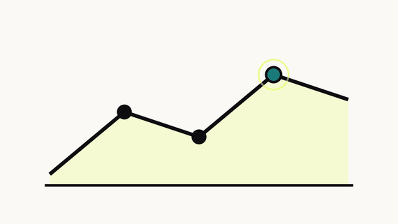

Audit Simulation Technique Training

Audit Simulation 2026

Technique Training · 23/10

Progress0 lessons

Introduction

[★Trang chủ  
Lộ trình buổi training · 45 phút](#home)

Phần 1 · Nền tảng · 8 phút

[★Tổng quan  
Mục tiêu Phần 1](#p1)
[1TB, GL và subledger  
4 phút · Dữ liệu đi từ chứng từ lên BCTC](#p1l1)
[2Mục đích của kiểm toán  
4 phút · Ý kiến · Vouching vs tracing](#p1l2)
[✓Phần 1 · Kiểm tra  
4 câu · kiểm tra toàn phần](#p1t)

Phần 2 · Materiality · 7 phút

[★Tổng quan  
Mục tiêu Phần 2](#p2)
[1Ba mức trọng yếu  
3 phút · OM · PM · CTT](#p2l1)
[2Test dựa vào materiality  
4 phút · Key items · Mẫu · Suy rộng](#p2l2)
[✓Phần 2 · Kiểm tra  
4 câu · kiểm tra toàn phần](#p2t)

Phần 3 · Thủ tục theo phần hành · 27 phút

[★Tổng quan  
Audit scope · Khung 6 bước](#p3)
[1Doanh thu  
7 phút · 7 bước audit program](#p3l1)
[2Phải thu khách hàng  
3 phút · 6 bước · Xác nhận · Dự phòng](#p3l2)
[3Phải trả người bán  
3 phút · 6 bước · Nợ chưa ghi nhận](#p3l3)
[4Chi phí hoạt động  
3 phút · 6 bước · Phân loại · 242](#p3l4)
[5Vay và lãi vay  
3 phút · 6 bước · Tính lại lãi](#p3l5)
[6Tài sản cố định  
3 phút · 6 bước · Khấu hao](#p3l6)
[7Bút toán tay & bên liên quan  
5 phút · 6 bước · Xuyên suốt](#p3l7)
[✓Phần 3 · Kiểm tra  
7 câu · kiểm tra toàn phần](#p3t)

Kết · 3 phút

[★Từ thủ tục đến finding  
3 phút · Mini working paper](#fin)

© BISC Training Center · Audit Simulation 2026 · Technique Training

☰

Trang chủ

BISC · Audit Simulation 2026

## Technique Training

Từ TB, GL đến finding: kỹ thuật kiểm toán cho từng phần hành trọng tâm.

 Bắt đầu

23/10/202645 phút3 phần · 12 bài

Nền tảng TB · GLPhần 1 · 8 phút
MaterialityPhần 2 · 7 phút
Thủ tục theo phần hànhPhần 3 · 27 phút

010203

Audit technique

## Từ số liệu đến finding

Ba câu hỏi đi suốt buổi training

Test **cái gì**Test **bao nhiêu**Kết luận **thế nào**

Sổ cái · GL
Bảng CĐPS · TB

### Dữ liệu là điểm xuất phát

- Reconcile **trước** khi test
- Kết luận trên **TB**, chọn mẫu trên **GL**
- Bằng chứng **bên ngoài** đáng tin hơn

### Materiality là thước đo

- **OM** cho toàn bộ báo cáo tài chính
- **PM** cho từng khoản mục
- **CTT** cho từng sai sót

Suy rộng **rồi mới** so ngưỡng

Our Training Workflow

Lộ trình 45 phút · đi đúng dòng chảy của một cuộc kiểm toán

1

#### Nền tảng

8 phút

TB, GL, subledger và mục đích cuối cùng của kiểm toán

2

#### Materiality

7 phút

Ba mức trọng yếu quyết định test cái gì, test bao nhiêu

3

#### Thủ tục theo phần hành

27 phút

Từng phần hành theo audit program: hiểu quy trình → reconcile → test → kết luận

4

#### Ghi finding

3 phút

Từ thủ tục đến mini working paper

Technique training · Phần 1 · 8 phút

Nền tảng: TB, GL và mục đích kiểm toán

Biết số liệu đi từ chứng từ lên BCTC thế nào thì mới biết phải test ở đâu.

Bắt đầu học → Bài 1.1

## Sau Phần 1, bạn sẽ:

1. Đọc được bộ dữ liệu

- Phân biệt TB, GL và subledger
- Biết số nào để kết luận, dòng nào để chọn mẫu
- Reconcile trước khi test

2. Hiểu đích đến

- Ý kiến kiểm toán dựa vào đâu
- Chọn đúng chiều: vouching hay tracing
- Xếp hạng độ tin cậy của bằng chứng

Audit Simulation 2026 · Technique Training · BISC Training Center

Phần 1 · Nền tảng / **Bài 1.1**

Bài 1.1 — Bộ dữ liệu kế toán · 4 phút

# TB, GL và subledger

Ba tầng của cùng một bộ số: **kết luận trên TB**, **chọn mẫu trên GL**, **test trên chứng từ**.

Dòng chảy số liệu

## Từ chứng từ lên BCTC

Bấm vào thẻ để đi lên tầng tiếp theo.

Tầng 1

Chứng từ gốc

Hợp đồng · hóa đơn · phiếu xuất · biên bản

Bằng chứng giao dịch có thật. Nơi **vouching** đi tới.

Tầng 2

Subledger

Chi tiết theo từng đối tượng

Theo **khách hàng, nhà cung cấp, tài sản, khoản vay**. Tổng phải bằng sổ cái.

Tầng 3

GL · Sổ cái

Từng bút toán

**Population** để chọn mẫu. Có người lập, ngày nhập.

Tầng 4

TB · Cân đối phát sinh

Số dư từng tài khoản

**Kết luận** trên con số này.

Tầng 5

BCTC

Số công bố

Ý kiến kiểm toán nói về con số này.

Chứng từSubledgerGLTBBCTC

Mỗi lần chuyển tầng là một điểm có thể sai: ghi thiếu · sai kỳ · kết chuyển sai

Ba tài liệu — ba vai trò

## Dùng tài liệu nào để làm gì

01 · TB

### Trial BalanceBảng cân đối phát sinh

**Kết luận** trên con số này.

Số dư từng TKĐầu kỳ · phát sinh · cuối kỳ

02 · GL

### General LedgerSổ cái

**Population** để chọn mẫu.

Từng bút toánNgười lập · ngày nhập

03 · Subledger

### SubledgerSổ chi tiết

**Test chi tiết** theo từng đối tượng.

Bảng tuổi nợSổ TSCĐLịch vay

Mô hình hóa

## Một con số, ba tầng: TK 131

Số liệu minh họa, đơn vị tỷ đồng.

131 · Phải thu KH TB

Đầu kỳ **50**

Phát sinh Nợ **800**

Phát sinh Có **(780)**

Cuối kỳ **70**

→chi tiết

Sổ cái 131 GL

Tài khoản 131

Nợ

Đầu kỳ **50**

Bán chịu **800**

Có

Thu tiền **780**

Dư cuối **70**

→đối tượng

131 theo khách hàng Subledger

Khách hàng A **32**

Khách hàng B **23**

Các khách khác **15**

Σ = TB **70 ✓**

Bước 1 của mọi phần hành

## Reconcile trước khi test

Báo cáo**BCTC**

=

Bảng CĐPS**TB**

=

Sổ cái**GL**

=

Sổ chi tiết**Σ Subledger**

⚠️

**Nếu bỏ qua:** bút toán thiếu trong GL không bao giờ nằm trong population, nên không mẫu nào tìm ra.

Kiểm tra nhanh

?Tổng GL 511 thấp hơn số dư 511 trên TB 1,2 tỷ. Có chọn mẫu MUS ngay được không?

Click để xem đáp án

Chưa

Tìm nguyên nhân chênh lệch trước: bút toán thiếu, kết chuyển, bút toán đảo. Mẫu chọn trên population thiếu thì kết luận không áp dụng được cho số trên BCTC.

[← Trang trước

Tổng quan Phần 1](#p1)[Tiếp →

1.2 — Mục đích của kiểm toán](#p1l2)

Phần 1 · Nền tảng / **Bài 1.2**

Bài 1.2 — Đích đến · 4 phút

# Mục đích cuối cùng của kiểm toán

VSA 200 · VSA 700

BCTC có trung thực và hợp lý, trên các khía cạnh trọng yếu?

Kiểm toán viên trả lời câu hỏi này bằng **ý kiến kiểm toán**. Mọi thủ tục trong cuộc thi đều phục vụ nó.

Trong cuộc thi

## Bốn việc để đi tới ý kiến

1

### Tìm sai sót

Thủ tục trên từng phần hành

2

### Lượng hóa

Số tiền · ghi thừa hay thiếu

3

### Đề xuất điều chỉnh

Bút toán Nợ / Có

4

### So với OM

Tổng sai sót chưa điều chỉnh

Ra quyết định

## Từ tổng sai sót đến ý kiến

Tổng sai sót chưa điều chỉnh **vượt OM**?

Không

Chấp nhận toàn phần

BCTC trung thực và hợp lý

Có

Ngoại trừ

Trái ngược nếu ảnh hưởng lan tỏa · VSA 705

Chọn đúng chiều

## Vouching hay tracing

Sổ sách · GL

↓

Chứng từ gốc

Top-down

Rủi ro ghi khống

Vouching

Occurrence · Existence

Chọn từ **sổ**, đi tìm **chứng từ**. Dùng cho doanh thu và tài sản.

Doanh thuPhải thuTSCĐ

Sổ sách · GL

↑

Nguồn bên ngoài

Bottom-up

Rủi ro ghi thiếu

Tracing

Completeness

Đi từ **nguồn** dò vào **sổ**. Dùng cho nợ phải trả và chi phí.

Phải trảChi phíVay

🔑

**Chọn sai chiều** thì test kỹ đến mấy cũng không thấy sai sót.

Bằng chứng · VSA 500

## Bằng chứng nào đáng tin hơn

Thư xác nhận gửi thẳng KTV · KTV tự tính lại

Chứng từ bên ngoài sổ phụ ngân hàng · hóa đơn NCC

Chứng từ nội bộ phiếu kế toán · bảng tính

Giải trình miệng của đơn vị

↑ Càng lên cao càng tin cậy · mỗi phần hành cần ít nhất một bằng chứng bên ngoài

Kiểm tra nhanh

?Chọn 30 hóa đơn trong hồ sơ rồi dò vào sổ 511. Thủ tục này có phát hiện được doanh thu ghi khống không?

Click để xem đáp án

Không

Đây là tracing, kiểm tra completeness. Bút toán khống không có hóa đơn thật để chọn. Muốn kiểm tra occurrence thì chọn từ GL 511 rồi đi tìm chứng từ.

[← Trang trước

1.1 — TB, GL và subledger](#p1l1)[Tiếp →

Phần 1 · Kiểm tra](#p1t)

Phần 1 · Nền tảng / **Bài kiểm tra chốt**

✓ Bài kiểm tra chốt

# Phần 1 — Bài kiểm tra chốt

4 câu: TB, GL, reconcile, chiều kiểm tra và bằng chứng. Mục tiêu: 4/4.

Q1 Kiểm toán viên đưa ra kết luận trên số liệu của tài liệu nào? [1]

A. Subledger
B. GL
C. TB, vì BCTC được lập từ TB
D. Chứng từ gốc

**Đáp án C.** BCTC được lập từ TB, nên kết luận cuối cùng là về số trên TB/BCTC. GL là population để chọn mẫu, chứng từ là nơi lấy bằng chứng.

Q2 Vì sao phải reconcile GL với TB trước khi chọn mẫu? [1]

A. Để tính PM
B. Để chắc population đầy đủ: bút toán thiếu trong GL không bao giờ được chọn
C. Để giảm số mẫu
D. Vì chuẩn mực cấm chọn mẫu trên TB

**Đáp án B.** Nếu GL thiếu bút toán thì không thủ tục chọn mẫu nào tìm ra, vì bút toán đó không nằm trong population.

Q3 Muốn kiểm tra doanh thu ghi khống (occurrence), nên đi theo chiều nào? [1]

A. Từ hóa đơn trong hồ sơ dò vào sổ
B. Từ GL 511 đi tìm chứng từ
C. Gửi xác nhận cho nhà cung cấp
D. Phân tích tỷ suất lợi nhuận gộp

**Đáp án B.** Vouching: chọn từ sổ rồi đi tìm bằng chứng. Bút toán khống không có chứng từ thật để dò ngược.

Q4 Bằng chứng nào tin cậy nhất? [1]

A. Giải trình miệng của kế toán trưởng
B. Bảng tính nội bộ của đơn vị
C. Thư xác nhận ngân hàng gửi thẳng cho KTV
D. Bản photo hóa đơn

**Đáp án C.** Bằng chứng từ bên thứ ba, gửi trực tiếp cho KTV, tin cậy hơn tài liệu do đơn vị lập hay giải trình miệng (VSA 500).

[← Trang trước

1.2 — Mục đích của kiểm toán](#p1l2)[Tiếp →

Tổng quan Phần 2](#p2)

Technique training · Phần 2 · 7 phút

Materiality, thước đo của cuộc kiểm toán

Ba mức trọng yếu quyết định test cái gì, test bao nhiêu và sai sót nào phải báo cáo.

Bắt đầu học → Bài 2.1

## Sau Phần 2, bạn sẽ:

1. Xác định ba mức trọng yếu

- Chọn benchmark phù hợp
- Tính OM, PM, CTT và biết mỗi mức dùng ở bước nào
- Không nhầm chữ “PM” giữa các firm

2. Dùng materiality để test

- Xác định khoản mục phải test
- Tách key items, chọn mẫu phần còn lại
- Suy rộng sai sót rồi mới so ngưỡng

Audit Simulation 2026 · Technique Training · BISC Training Center

Phần 2 · Materiality / **Bài 2.1**

Bài 2.1 — Xác định trọng yếu · 3 phút

# Ba mức trọng yếu

Chọn benchmark, tính OM, rồi suy ra PM và CTT. Điều cần bảo vệ được là **lý do chọn benchmark**, không phải con số.

Bước 1 · Chọn benchmark

## Benchmark tham khảo cho OM

Lợi nhuận trước thuế

5%

Doanh nghiệp có lãi, ổn định

Doanh thu

0,5–1%

Lỗ hoặc lợi nhuận biến động mạnh

Tổng tài sản

1–2%

Doanh nghiệp nặng tài sản

PM = 50–75% × OMCTT = 3–5% × OMRủi ro cao → chọn mức thấp

Ví dụ minh họa

## Công ty A: lợi nhuận trước thuế 5 tỷ

01 · OM

### Overall materialityMức trọng yếu tổng thể

250 triệu

Thước đo cho **toàn bộ BCTC**.

5% × LNTT 5 tỷ

02 · PM

### Performance materialityMức trọng yếu thực hiện

175 triệu

Thiết kế thủ tục **từng khoản mục**.

70% × OM

03 · CTT

### Clearly trivialNgưỡng sai sót không đáng kể

12,5 triệu

Dưới mức này: **không tổng hợp**.

5% × OM

Thử ngay

## Đặt sai sót lên thước đo

**Kéo nút đỏ để đổi số tiền sai sót**Theo ví dụ Công ty A · thước vẽ đúng tỷ lệ, đơn vị triệu đồng

Tương tác

CTT **12,5**

PM **175**

OM **250**

050100150200250300

Sai sót đã suy rộng60 triệu

Từ CTT 12,5 triệu: đưa vào bảng tổng hợp sai sót

**Dưới 12,5 triệu**Không tổng hợp, trừ dấu hiệu gian lận

**Từ 12,5 triệu**Đưa vào bảng tổng hợp sai sót

**Vượt 175 triệu ở một khoản mục**Mở rộng thủ tục ở khoản mục đó

**Vượt 250 triệu**Ảnh hưởng ý kiến nếu không điều chỉnh

Vì sao PM thấp hơn OM

## Vùng đệm cho sai sót chưa phát hiện

PM 175 triệudùng để thiết kế thủ tục

Vùng đệm 75 triệusai sót chưa phát hiện + cộng dồn

OM 250 triệu = PM + vùng đệm · rủi ro càng cao thì PM càng thấp, vùng đệm càng rộng

Cẩn thận tên gọi

## Cùng chữ “PM”, hai nghĩa khác nhau

| VSA / ISA | EY | KPMG | Deloitte · PwC |
| --- | --- | --- | --- |
| Overall materiality | PM · Planning materiality | Materiality | Overall materiality |
| Performance materiality | TE · Tolerable error | Performance materiality | PM · Performance materiality |
| Clearly trivial | SAD nominal amount | AMPT | Clearly trivial |

⚠️

**Trong ebook này:** PM là Performance materiality. Đọc tài liệu nào cũng phải xác định PM đang mang nghĩa gì trước khi tính.

Kiểm tra nhanh

?Công ty A có tổng sai sót chưa điều chỉnh 220 triệu, OM 250 triệu. Ý kiến kiểm toán có bị ảnh hưởng không?

Click để xem đáp án

Chưa, nhưng đã sát ngưỡng

220 triệu vẫn dưới OM 250 triệu. Vùng đệm chỉ còn 30 triệu cho sai sót chưa phát hiện, nên làm thêm thủ tục ở khoản mục rủi ro cao.

[← Trang trước

Tổng quan Phần 2](#p2)[Tiếp →

2.2 — Test dựa vào materiality](#p2l2)

Phần 2 · Materiality / **Bài 2.2**

Bài 2.2 — Từ thước đo đến mẫu · 4 phút

# Test dựa vào materiality

Bốn bước, mỗi bước dùng một mức trọng yếu. Tiếp tục ví dụ Công ty A: **OM 250 · PM 175 · CTT 12,5 triệu**.

Từng bước

## Bốn bước

Bấm từng bước bên trái để xem.

1ScopingSo với PM
2Tách key itemsNgưỡng ≤ PM
3Chọn mẫuPhần còn lại
4Suy rộng & đánh giáCTT · PM · OM

◆ Bước 1 · So số dư với PM

### Khoản mục nào phải test?

Số dư hoặc phát sinh > PM

→

Khoản mục trọng yếuthủ tục cơ bản

Nhỏ nhưng dễ ghi thiếuphải trả · chi phí · vay

→

Vẫn phải testsố nhỏ có thể do ghi thiếu

Nhỏ, rủi ro thấp

→

Phân tích tổng quát

◆ Bước 2 · Ngưỡng key item ≤ PM

### Tách key items, test 100%

Key itemstest 100%

Phần còn lạichọn mẫu → suy rộng

Population GL của một khoản mục · tỷ lệ minh họa

Ngưỡng ≤ PMRủi ro cao → hạ ngưỡng

Sai sót ở key items cộng thẳng, **không suy rộng**.

◆ Bước 3

### Chọn mẫu đúng phương pháp

| Phương pháp | Dùng khi |
| --- | --- |
| MUS | Rủi ro ghi khống: doanh thu, phải thu, TSCĐ |
| Random · Systematic | Population đồng đều; test completeness từ nguồn |
| Block | Cut-off quanh ngày khóa sổ |
| Lọc theo tiêu chí | Bút toán tay, khoản bất thường. Không phải sampling |

Không dùng MUS để tìm ghi thiếu: khoản bị ghi thiếu có số dư nhỏ nên ít khi được chọn.

◆ Bước 4 · CTT → PM → OM

### Suy rộng rồi mới so ngưỡng

Sai sót suy rộngSai sót trong mẫu **÷** Giá trị mẫu **×** Giá trị population

≥ CTTvào bảng tổng hợp

→

Khoản mục > PMmở rộng thủ tục

→

Tổng > OMảnh hưởng ý kiến

Ví dụ

## Sai sót doanh thu suy rộng thế nào?

### Ví dụ — **MUS trên GL doanh thu**

**9 tỷ**Population, không gồm key items

**600 tr**Giá trị mẫu

**6 tr**Sai sót trong mẫu

Với OM 250 · PM 175 · CTT 12,5 triệu: sai sót suy rộng bao nhiêu? Có vào bảng tổng hợp không? Có phải mở rộng thủ tục không?

### Bài làm **của bạn**

Nộp bài ✓

Lời giải

1Tỷ lệ sai: 6 tr ÷ 600 tr = **1%**

2Suy rộng: 1% × 9 tỷ = **90 triệu**

390 tr ≥ CTT 12,5 tr → **vào bảng tổng hợp**

490 tr < PM 175 tr → chưa bắt buộc mở rộng, vẫn cộng vào tổng để so với OM

Thử ngay

## Máy tính suy rộng

**Đổi số liệu để xem kết luận thay đổi**Phương pháp tỷ lệ · ngưỡng theo ví dụ Công ty A

Tương tác

Population

tỷ đồng, không gồm key items

Giá trị mẫu

tỷ đồng

Sai sót trong mẫu

triệu đồng

Tỷ lệ sai**1,00%**

Sai sót suy rộng**90 triệu**

So với PM 175 triệu**51%**

Từ CTT 12,5 triệu: đưa vào bảng tổng hợp. Chưa vượt PM.

⚠️

**Không chia nhỏ** một sai sót cùng bản chất để từng phần lọt dưới CTT.

[← Trang trước

2.1 — Ba mức trọng yếu](#p2l1)[Tiếp →

Phần 2 · Kiểm tra](#p2t)

Phần 2 · Materiality / **Bài kiểm tra chốt**

✓ Bài kiểm tra chốt

# Phần 2 — Bài kiểm tra chốt

4 câu: ba mức trọng yếu và cách dùng chúng khi test. Mục tiêu: 4/4.

Q1 Công ty B có lợi nhuận trước thuế 8 tỷ. Chọn OM = 5% LNTT và PM = 60% OM. PM bằng bao nhiêu? [1]

A. 400 triệu
B. 240 triệu
C. 20 triệu
D. 480 triệu

**Đáp án B.** OM = 5% × 8 tỷ = 400 triệu; PM = 60% × 400 triệu = 240 triệu. Nếu CTT = 5% × OM thì CTT = 20 triệu.

Q2 Công ty A (CTT 12,5 triệu, PM 175 triệu): sai sót trong mẫu là 5 triệu, suy rộng ra population được 60 triệu. Kết luận: [1]

A. Bỏ qua vì 5 triệu < 12,5 triệu
B. Đưa vào bảng tổng hợp vì 60 triệu ≥ 12,5 triệu
C. Phải mở rộng thủ tục vì đã vượt PM
D. Chỉ ghi nhận nếu là gian lận

**Đáp án B.** Luôn so sai sót đã suy rộng với CTT, không so sai sót thô trong mẫu. 60 triệu vẫn dưới PM 175 triệu nên chưa bắt buộc mở rộng thủ tục.

Q3 Sai sót tìm thấy ở key items (test 100%) được xử lý thế nào? [1]

A. Suy rộng ra toàn bộ population
B. Cộng thẳng, không suy rộng
C. Bỏ qua nếu dưới PM
D. Chia đôi rồi suy rộng

**Đáp án B.** Key items là chọn item cụ thể, không phải sampling. Sai sót ở đó cộng thẳng vào tổng.

Q4 Ở EY, chữ “PM” nghĩa là gì? [1]

A. Performance materiality
B. Planning materiality, tức mức trọng yếu tổng thể
C. Ngưỡng sai sót không đáng kể
D. Mức trọng yếu cho từng khoản mục

**Đáp án B.** EY: PM = Planning materiality (mức tổng thể), TE = Tolerable error. Ở Deloitte và PwC, PM là Performance materiality, như cách dùng trong ebook này.

[← Trang trước

2.2 — Test dựa vào materiality](#p2l2)[Tiếp →

Tổng quan Phần 3](#p3)

Technique training · Phần 3 · 27 phút

Thủ tục theo từng phần hành

Sáu chu trình trọng tâm và một lớp soát xét xuyên suốt. Phần hành nào cũng đi theo audit program: hiểu quy trình trước, kết luận sau cùng.

Bắt đầu học → Bài 3.1

Audit scope

## Sáu chu trình và lớp xuyên suốt

Bấm vào thẻ để mở bài. Số hiệu tài khoản theo hệ thống tài khoản VAS.

01

Revenue

### Doanh thu

511 · 521 · 3387

OccurrenceCut-off

02

Receivables

### Phải thu khách hàng

131 · 2293

ExistenceValuation

03

Payables

### Phải trả người bán

331 · 335

CompletenessCut-off

04

Operating expenses

### Chi phí hoạt động

632 · 641 · 642 · 242

CompletenessClassification

05

Borrowings

### Vay và lãi vay

341 · 635 · 335

CompletenessPresentation

06

Fixed assets

### Tài sản cố định

211 · 214 · 241

ExistenceValuation

07

Xuyên suốt · toàn bộ sổ cái

### Bút toán tay & bên liên quan

Toàn bộ GL · danh sách bên liên quan

OccurrenceCompletenessPresentation

Khung chung · audit program

## Mọi phần hành, 6 bước

1

### Hiểu quy trình

Walkthrough, rủi ro, kiểm soát

2

### Reconcile

Sổ chi tiết = GL = TB

3

### Phân tích

Lập kỳ vọng, tìm biến động

4

### Test chi tiết

Key items + mẫu

5

### Cut-off & sau kỳ

Quanh ngày khóa sổ

6

### Kết luận

Suy rộng, so ngưỡng

Audit Simulation 2026 · Technique Training · BISC Training Center

Phần 3 · Thủ tục theo phần hành / **Bài 3.1**

Bài 3.1 — Chu trình 01 · 7 phút

# Chu trình doanh thu

Chu trình 01 · Revenue · VSA 240

Doanh thu có thật và ghi đúng kỳ?

Rủi ro gian lận được giả định có ở doanh thu.

Tài khoản5115213387131

AssertionOccurrenceCompletenessCut-offAccuracy

Dữ liệuDetail listingGL 511Hợp đồng · hóa đơnSổ phụ

Audit program

## Bảy bước, đi đúng thứ tự

Bấm một bước để nhảy tới phần đó.

1Hiểu quy trìnhWalkthrough
2ReconcileDetail listing = GL
3Phân tíchKỳ vọng so với sổ
4Test chi tiếtVouching · tracing
5Cut-offQuanh 31/12
6Sau kỳ · JEGiảm trừ · ghi tay
7Kết luậnSo ngưỡng

Bước**1**

Understanding · walkthrough

## Hiểu quy trình bán hàng

Mục tiêuBiết rủi ro nằm ở khâu nàoBiết chứng từ nào sinh ra ở đâu

**Nhận đơn hàng**Đơn đặt hàng · hợp đồngDuyệt hạn mức tín dụng

→

**Giao hàng**Phiếu xuất · biên bản giao nhậnKhách ký nhận

→

**Xuất hóa đơn**Hóa đơn GTGTKhớp với phiếu giao

→

**Ghi sổ**Nợ 131 / Có 511Hệ thống tự hạch toán

→

**Thu tiền**Sổ phụ · Nợ 112 / Có 131Đối chiếu công nợ

Kiểm soát chính: hỏi, quan sát, xem lại chứng từRủi ro cần đưa vào các bước sau

Ghi khốngHóa đơn không có giao hàng thật → Bước 4

Sai kỳGiao hàng năm sau, ghi doanh thu năm nay → Bước 5

Ghi thiếuĐã giao hàng nhưng chưa xuất hóa đơn → Bước 4

### Doanh thu ghi nhận khi nào?

Bán hàng

### Giao hàng xong mới ghi

Tại một thời điểm

Nợ 131 / Có 511

Đơn hàng*→*Biên bản giao hàng*→*Hóa đơn

Dịch vụ theo kỳ

### Gói hội viên 12 tháng

Chia theo tháng

3387 → 511 mỗi tháng

Hợp đồng*→*Thu tiền trước*→*Phân bổ theo tháng

Thu tiền trước

### Bán vé tháng 3, bay tháng 6

Khi thực hiện

Tháng 3: 3387 · Tháng 6: 511

Bán vé*→*Ghi 3387*→*Chuyến bay*→*Doanh thu

**Output**Sơ đồ quy trình · walkthrough một giao dịch từ đơn hàng đến tiền về · danh sách rủi ro và kiểm soát chính

Bước**2**

Reconcile · chốt population

## Detail listing khớp GL, TB và BCTC

Completeness của populationAccuracy

Detail listing**Σ hóa đơn**

=

Sổ cái**GL 511**

=

Bảng CĐPS**TB**

=

Báo cáo**BCTC**

Trước khi soCộng lại detail listingLoại kết chuyển 511 → 911Loại bút toán đảo

Lệch thì **dừng lại tìm nguyên nhân**. Chỉ detail listing đã khớp mới dùng làm population để chọn mẫu ở Bước 4.

**Output**Lead schedule doanh thu · bảng đối chiếu detail listing với GL, TB

Bước**3**

Substantive analytics

## Lập kỳ vọng, so với sổ

OccurrenceCompleteness

Kỳ vọng doanh thu từng thángSản lượng bán **×** Giá bán bình quân

*T1*
*T2*
*T3*
*T4*
*T5*
*T6*
*T7*
*T8*
*T9*
*T10*
*T11*
*T12***+40%**

Doanh thu trên sổKỳ vọngLệch vượt ngưỡng

Lệch vượt ngưỡng

→

Hỏi đơn vị

→

Bằng chứng giải thíchhợp đồng mới · tăng giá

→

Không giải thích được→ tăng test chi tiết

**Output**Bảng phân tích theo tháng, theo sản phẩm · giải thích từng biến động lớn · số liệu minh họa

Bước**4**

Test of details

## Test chi tiết theo hai chiều

OccurrenceAccuracyCompleteness

**Vouching**chọn từ sổ, đi tìm chứng từOccurrence · Accuracy

Detail listingkey items + MUS

→

Hóa đơnkhớp khách hàng, số tiền

→

Giao hàng · nghiệm thucó xác nhận của khách

→

Tiền vềsổ phụ ngân hàng

**Tracing**chọn từ nguồn, dò vào sổCompleteness

Phiếu xuất · biên bản giaochọn random

→

Đã xuất hóa đơn?

→

Có trong GL 511?đúng kỳ, đúng số tiền

Sai sót trong mẫu phải **suy rộng**; sai sót ở key items cộng thẳng (Bài 2.2).

**Output**Danh sách mẫu và cách chọn · kết quả từng mẫu · sai sót đã suy rộng

Bước**5**

Cut-off

## Ghi đúng kỳ quanh 31/12

Cut-offChọn mẫuBlock selection

*Block 5–10 ngày mỗi bên*

31/12/2025

16/1215/01

← Doanh thu 2025Doanh thu 2026 →

Mốc ghi nhậnHàng hóa: ngày giaoDịch vụ theo kỳ: tháng sử dụngThu trước: ngày thực hiện

**Thử ngay: gói dịch vụ trả trước**Doanh thu ghi theo tháng sử dụng · khóa sổ 31/12/2025

Tương tác

Giá trị gói

triệu đồng, thu đủ khi ký

Tháng bắt đầuTháng 1/2025Tháng 2/2025Tháng 3/2025Tháng 4/2025Tháng 5/2025Tháng 6/2025Tháng 7/2025Tháng 8/2025Tháng 9/2025Tháng 10/2025Tháng 11/2025Tháng 12/2025

tháng đầu tiên dùng dịch vụ

Thời hạn gói

tháng

Doanh thu 2025Còn trên 3387 tại 31/12/2025

Doanh thu 2025**30 triệu**

Số dư 3387 cuối năm**90 triệu**

3/12 tháng thuộc năm 2025. Ghi hết vào doanh thu khi thu tiền → doanh thu 2025 ghi thừa 90 triệu.

**Output**Danh sách giao dịch trong block · ngày giao hàng so với ngày ghi sổ · kết luận đúng kỳ

Bước**6**

Subsequent review · manual JE

## Soát xét sau kỳ và bút toán tay

OccurrenceCut-offManagement override

**Giảm trừ đầu năm sau**xem tháng 1–2/2026

Hàng trả lại · chiết khấuhóa đơn điều chỉnh, hủy

→

Liên quan doanh thu 2025?

→

Có→ doanh thu 2025 ghi thừa

**Bút toán tay ghi Có 511**không đi từ hệ thống bán hàng

Lọc GL 511bút toán thủ công

→

Người lập, ngày nhập bất thường

→

Vouch + phê duyệtcách lọc ở Bài 3.7

**Output**Danh sách giảm trừ sau kỳ đã xem xét · danh sách bút toán tay đã kiểm tra

Bước**7**

Evaluate · conclude

## Tổng hợp sai sót, kết luận phần hành

1

Lượng hóa

Key items cộng thẳng · mẫu suy rộng

→

2

So CTT

Từ CTT trở lên → bảng tổng hợp

→

3

So PM

Vượt PM → mở rộng thủ tục

→

4

Kết luận

Bút toán điều chỉnh đề xuất

**Output**Mini working paper cho từng finding (phần Kết) · kết luận cho khoản mục doanh thu

Dấu hiệu cần đào sâu

## Red flags

Dồn vào tháng 12

Không khớp sản lượng, số hợp đồng

Ghi tay

Không qua hóa đơn hay hệ thống bán hàng

Trả lại đầu năm

Doanh thu tháng 12 bị đảo ở tháng 1

Thu trước ghi ngay

Dịch vụ chưa thực hiện đã vào 511

[← Trang trước

Tổng quan Phần 3](#p3)[Tiếp →

3.2 — Phải thu khách hàng](#p3l2)

Phần 3 · Thủ tục theo phần hành / **Bài 3.2**

Bài 3.2 — Chu trình 02 · 3 phút

# Phải thu khách hàng

Chu trình 02 · Accounts receivable

Khoản phải thu có tồn tại và thu được?

Tài khoản1312293642

AssertionExistenceValuationClassification

Dữ liệuBảng tuổi nợSổ chi tiết 131Sổ phụThư xác nhận

Audit program

## Sáu bước cho phải thu

1Hiểu quy trìnhBán chịu → thu tiền
2ReconcileAging = GL
3Phân tíchSố ngày thu tiền
4Xác nhậnExistence
5Dự phòngValuation
6Trình bày · kết luậnKhông bù trừ

Bước**1**

Understanding

## Hiểu quy trình bán chịu và thu tiền

**Bán chịu**Hóa đơn · Nợ 131Duyệt hạn mức tín dụng

→

**Theo dõi công nợ**Sổ chi tiết theo khách hàngĐối chiếu công nợ định kỳ

→

**Thu tiền**Sổ phụ · Có 131Người thu ≠ người ghi sổ

→

**Đánh giá nợ quá hạn**Bảng tuổi nợ · 2293Duyệt trích lập, xóa nợ

Kiểm soát chínhRủi ro

Không tồn tạiSố dư không có khách hàng thật → Bước 4

Đánh giá caoNợ khó đòi chưa trích dự phòng → Bước 5

Phân loại saiDư Có bù trừ vào dư Nợ → Bước 6

**Output**Sơ đồ quy trình · chính sách tín dụng và trích lập dự phòng của đơn vị

Bước**2**

Reconcile

## Bảng tuổi nợ khớp GL và TB

CompletenessAccuracy

Bảng tuổi nợtheo từng khách hàng

=

GL 131

=

TB

Kiểm tra thêmCộng dọc, cộng ngangTách dư Có 131

**Output**Bảng tuổi nợ đã đối chiếu · population cho Bước 4 và 5

Bước**3**

Analytics

## Số ngày thu tiền có bất thường?

ExistenceValuation

Số ngày thu tiền bình quânPhải thu bình quân **÷** Doanh thu **×** 365

So năm trước · so chính sách tín dụng

→

Tăng mạnh?

→

Nghi ghi khống hoặc nợ khó đòidồn trọng tâm vào Bước 4–5

**Output**Bảng phân tích số ngày thu tiền, tỷ trọng nợ quá hạn so với năm trước

Bước**4**

Confirmation

## Xác nhận số dư với khách hàng

ExistenceChọn mẫuKey items + MUS

**Đơn vị được kiểm toán**ghi nhận 131

Hóa đơn · giao hàng

Tiền về tài khoản

**Khách hàng**bên thứ ba độc lập

Thư xác nhận

Phản hồi thẳng KTV

**Kiểm toán viên**tự gửi, tự nhận thư

Không phản hồi

→

Thủ tục thay thế

→

Tiền thu sau 31/12hoặc hóa đơn + bằng chứng giao hàng

**Output**Bảng theo dõi thư xác nhận: gửi, nhận, chênh lệch và cách giải quyết

Bước**5**

Valuation

## Test tuổi nợ, tính lại dự phòng

Valuation

Chọn hóa đơn

→

Ngày đến hạn đúng nhóm tuổi?

→

Tính lại 2293theo khung trích lập

**Thử ngay: từ tuổi nợ đến dự phòng**Khung trích lập theo Thông tư 48/2019 · tính trên từng khoản nợ

Tương tác

30%

50%

70%

100%

6 tháng – dưới 1 nămquá hạn

1 – dưới 2 nămquá hạn

2 – dưới 3 nămquá hạn

Từ 3 nămquá hạn

Số dư phải thu

tỷ đồng

Số tháng quá hạn

tháng

Nhóm tuổi nợ**1 – dưới 2 năm**

Tỷ lệ tối thiểu**50%**

Dự phòng tối thiểu**1 tỷ**

So với số đã trích trên 2293. Trích thiếu → lợi nhuận ghi thừa.

**Output**Bảng tính lại dự phòng, chênh lệch so với số đã trích trên 2293

Bước**6**

Presentation · conclude

## Trình bày đúng, rồi kết luận

ClassificationPresentation

Dư Nợ 131tài sản

≠

Dư Có 131người mua trả tiền trước

→

Không bù trừtrình bày riêng hai bên

Tách riêngPhải thu bên liên quanNgắn hạn · dài hạn

Sai sót đã lượng hóa

→

So CTT · PM

→

Bút toán điều chỉnh đề xuất

**Output**Kết luận phải thu · mini working paper cho từng finding

Dấu hiệu cần đào sâu

## Red flags

Phát sinh lớn tháng 12

Không có tiền về sau kỳ

Quá hạn lâu

Dự phòng thấp hoặc bằng 0

Bên liên quan

Số dư lớn, kéo dài, không tính lãi

[← Trang trước

3.1 — Doanh thu](#p3l1)[Tiếp →

3.3 — Phải trả người bán](#p3l3)

Phần 3 · Thủ tục theo phần hành / **Bài 3.3**

Bài 3.3 — Chu trình 03 · 3 phút

# Phải trả người bán

Chu trình 03 · Accounts payable

Có khoản nợ nào chưa ghi?

Rủi ro chính là ghi thiếu. Đi từ nguồn bên ngoài vào sổ.

Tài khoản331335

AssertionCompletenessCut-offClassification

Dữ liệuSổ chi tiết 331Sổ phụChứng từ chi sau kỳHóa đơn nhận sau kỳ

Audit program

## Sáu bước cho phải trả

1Hiểu quy trìnhMua hàng → thanh toán
2ReconcileChi tiết NCC = GL
3Phân tíchSố ngày phải trả
4Đối chiếu NCCTheo phát sinh
5Nợ chưa ghi nhậnSau 31/12
6Kết luậnSo ngưỡng

Bước**1**

Understanding

## Hiểu quy trình mua hàng và thanh toán

**Đặt mua**Đơn mua hàng (PO)Phê duyệt mua

→

**Nhận hàng**Phiếu nhập · biên bản nghiệm thuKiểm nhận số lượng

→

**Nhận hóa đơn**Hóa đơn nhà cung cấpĐối chiếu 3 chiều

→

**Ghi sổ**Nợ hàng · chi phí / Có 331Ghi nợ khi nhận hàng

→

**Thanh toán**Sổ phụ · Nợ 331Duyệt chi

Kiểm soát chính · đối chiếu 3 chiều: PO · phiếu nhập · hóa đơnRủi ro

Ghi thiếuĐã nhận hàng nhưng chưa ghi nợ → Bước 5

Sai kỳHóa đơn về sau 31/12 nên ghi năm sau → Bước 5

Phân loại saiDư Nợ 331 bù trừ vào dư Có → Bước 2

**Output**Sơ đồ quy trình · thời điểm đơn vị ghi nhận nợ phải trả

Bước**2**

Reconcile

## Chi tiết công nợ khớp GL và TB

CompletenessClassification

Sổ chi tiếttheo từng nhà cung cấp

=

GL 331

=

TB

Tách raDư Nợ 331 → trả trước người bán (tài sản)

**Output**Danh sách nhà cung cấp đã đối chiếu với GL, TB

Bước**3**

Analytics

## Số dư phải trả có hợp lý?

Completeness

Số ngày phải trả bình quânPhải trả bình quân **÷** Giá trị mua hàng **×** 365

331 giảm mạnh

+

Mua hàng, chi phí không giảm

→

Nghi ghi thiếudồn trọng tâm vào Bước 5

**Output**Bảng phân tích 331 và số ngày phải trả so với năm trước

Bước**4**

Supplier confirmation

## Chọn NCC theo phát sinh, không theo số dư

Completeness

Bỏ sótTheo số dư (MUS)✕ sai cách

Đúng cáchTheo giá trị mua trong năm✓ nên dùng

Ưu tiên **số dư lớn**

Ưu tiên NCC **giao dịch nhiều**

NCC **số dư 0** gần như không được chọn

**Gồm cả** NCC số dư 0

Hợp với rủi ro **ghi khống**

Hợp với rủi ro **ghi thiếu**

Chọn theo phát sinh mua

→

Supplier statement · thư xác nhận

→

So với sổ chi tiết 331

**Output**Bảng đối chiếu số dư theo NCC, chênh lệch và giải thích

Bước**5**

Search for unrecorded liabilities

## Nợ sinh ra khi nhận hàng, không phải khi nhận hóa đơn

CompletenessCut-off

**Nhà cung cấp**hàng hóa · dịch vụ · điện nước

Hàng, dịch vụ trước 31/12

Hóa đơn sau 31/12

**Đơn vị được kiểm toán**331 · 335

Thanh toán đầu năm sau

Sổ phụ ngân hàng

**Ngân hàng**bằng chứng bên ngoài

Chi tiền đầu năm sausổ phụ

+

Hóa đơn nhận sau kỳ

→

Nhận hàng, dịch vụ khi nào?

→

Trước 31/12→ ghi nợ năm nay

Test 100% khoản vượt ngưỡng. Đây là chọn item cụ thể, không phải sampling.

**Chi phí phải trả 335**tính lại khoản trích trước

Tính lại trích trướclãi vay · điện nước · dịch vụ

→

So với số thực tế phát sinh đầu năm sau

**Output**Danh sách khoản chi, hóa đơn sau kỳ đã kiểm tra · khoản nợ ghi thiếu (nếu có)

Bước**6**

Conclude

## Tổng hợp sai sót, kết luận

Sai sót đã lượng hóa

→

So CTT · PM

→

Bút toán điều chỉnh đề xuất

**Output**Kết luận phải trả · mini working paper cho từng finding

Dấu hiệu cần đào sâu

## Red flags

Hóa đơn về muộn

Dùng dịch vụ tháng 12, ghi nợ tháng 1

331 giảm mạnh

Chi phí không giảm tương ứng

Kiểm tra nhanh

?Hóa đơn điện tháng 12/2025 về ngày 08/01/2026, kế toán ghi chi phí tháng 1/2026. Đúng chưa?

Click để xem đáp án

Chưa

Điện đã dùng trong tháng 12/2025 nên nghĩa vụ phát sinh năm 2025. Phải trích chi phí và nợ phải trả (hoặc 335) vào năm 2025, dù hóa đơn về sau.

[← Trang trước

3.2 — Phải thu khách hàng](#p3l2)[Tiếp →

3.4 — Chi phí hoạt động](#p3l4)

Phần 3 · Thủ tục theo phần hành / **Bài 3.4**

Bài 3.4 — Chu trình 04 · 3 phút

# Chi phí hoạt động

Chu trình 04 · Operating expenses

Chi phí đủ, đúng kỳ, đúng ngăn?

Tài khoản632641642242335

AssertionCompletenessCut-offClassificationOccurrence

Dữ liệuGL chi phíBảng phân bổ 242Chi phí theo tháng

Audit program

## Sáu bước cho chi phí

1Hiểu quy trìnhĐề nghị → ghi sổ
2ReconcileChi tiết = GL
3Phân tíchTheo tháng
4VouchingKhoản lớn, bất thường
5242 · cut-offTính lại phân bổ
6Kết luậnSo ngưỡng

Bước**1**

Understanding

## Hiểu quy trình chi và phân loại chi phí

**Đề nghị chi**Đề nghị · hợp đồngDuyệt theo hạn mức

→

**Nhận dịch vụ**Biên bản nghiệm thuBộ phận sử dụng xác nhận

→

**Nhận hóa đơn**Hóa đơn · chứng từ chiKiểm tra hợp lệ

→

**Phân loại**632 · 641 · 642 · 242 · 211Kế toán trưởng duyệt

→

**Ghi sổ · phân bổ**GL · bảng phân bổ 242Phân bổ theo hợp đồng

Kiểm soát chínhRủi ro

Ghi thiếuChi phí tháng 12 chưa ghi → Bước 5

Phân loại saiChi phí đẩy sang 242 hoặc 241 → Bước 4–5

Không có thậtChi khống, chi cho bên liên quan → Bước 4

### Ba ngăn của một khoản chi

### Chi phí trong kỳ

Trừ vào lợi nhuận năm nay

632641642

⇄phân bổ sai

### Chi phí trả trước

Phân bổ dần theo thời gian hưởng lợi

242

⇄vốn hóa sai

### Tài sản

Khấu hao nhiều năm

211241

**Output**Sơ đồ quy trình · chính sách phân loại và phân bổ chi phí của đơn vị

Bước**2**

Reconcile

## Chi tiết chi phí khớp GL và TB

CompletenessAccuracy

Chi tiết theo khoản mục632 · 641 · 642

=

GL

=

TB

Bảng phân bổ 242số dư cuối kỳ

=

GL 242

=

TB

**Output**Bảng đối chiếu chi phí theo khoản mục và bảng phân bổ 242

Bước**3**

Analytics

## Phân tích theo tháng, so năm trước

CompletenessClassification

TB · cột năm trước

+

Chi phí theo tháng

→

Tháng thấp bất thườngnơi tìm chi phí ghi thiếu

**Output**Bảng biến động chi phí theo tháng và theo khoản mục, có giải thích

Bước**4**

Test of details

## Vouching khoản lớn và bất thường

OccurrenceClassification

Key items + MUS

+

Chọn có chủ đíchtư vấn · tiếp khách · bên liên quan

→

Hóa đơn · hợp đồng · nghiệm thu · phê duyệt

**Output**Danh sách mẫu, kết quả kiểm tra chứng từ và phân loại tài khoản

Bước**5**

Recalculation · cut-off

## Tính lại phân bổ 242, kiểm tra chi phí đúng kỳ

AccuracyCut-offCompleteness

07/202506/2027

6 tháng · chi phí 2025

18 tháng · còn trên 242

480 triệu × 6/24 = 120 triệu chi phí 2025

Ví dụ: hợp đồng bảo hiểm 24 tháng từ 01/07/2025 · 360 triệu còn lại trên 242

**Cut-off chi phí**làm chung với Bước 5 của Bài 3.3

Dịch vụ tháng 12hóa đơn về tháng 1

→

Trích trước vào năm nay335

**Output**Bảng tính lại phân bổ 242 so với sổ · danh sách chi phí trích trước

Bước**6**

Conclude

## Tổng hợp sai sót, kết luận

Sai sót đã lượng hóa

→

So CTT · PM

→

Bút toán điều chỉnh đề xuất

**Output**Kết luận chi phí · mini working paper cho từng finding

Dấu hiệu cần đào sâu

## Red flags

Sửa chữa đưa vào 241

Chi phí thường xuyên bị vốn hóa

Phân bổ quá dài

Số tháng dài hơn hợp đồng

Chi cho bên liên quan

Không có hợp đồng, nghiệm thu

Kiểm tra nhanh

?Phí bảo hiểm 12 tháng trả ngày 01/10/2025, ghi toàn bộ vào chi phí 2025. Sai ở đâu?

Click để xem đáp án

Chi phí ghi thừa

Chỉ 3/12 thuộc năm 2025. 9/12 còn lại phải nằm trên 242: chi phí ghi thừa, chi phí trả trước ghi thiếu.

[← Trang trước

3.3 — Phải trả người bán](#p3l3)[Tiếp →

3.5 — Vay và lãi vay](#p3l5)

Phần 3 · Thủ tục theo phần hành / **Bài 3.5**

Bài 3.5 — Chu trình 05 · 3 phút

# Vay và lãi vay

Chu trình 05 · Borrowings

Đủ khoản vay, đúng lãi, đúng phân loại?

Ít khoản vay, mỗi khoản lớn: **test 100%**, không chọn mẫu.

Tài khoản341635335241

AssertionCompletenessAccuracyPresentation

Dữ liệuLịch vayHợp đồng vay · khế ướcSổ phụXác nhận ngân hàng

Audit program

## Sáu bước cho vay

1Hiểu quy trìnhVay → trả nợ
2ReconcileLịch vay = GL · test 100%
3Tính lại lãi635 + 241
4Phân loạiNgắn hạn · dài hạn
5CovenantsCam kết · thuyết minh
6Kết luậnSo ngưỡng

Bước**1**

Understanding

## Hiểu quy trình vay và trả nợ

**Ký hợp đồng vay**Hợp đồng · hạn mức · lãi suấtHĐQT, BGĐ phê duyệt

→

**Giải ngân**Khế ước nhận nợ · sổ phụĐối chiếu sổ phụ

→

**Tính lãi**Thông báo lãi · 635 · 335Đối chiếu thông báo lãi

→

**Trả lãi, gốc**Lịch trả nợ · sổ phụTheo dõi ngày đến hạn

→

**Theo dõi cam kết**Chỉ tiêu tài chính trong hợp đồngBáo cáo cho ngân hàng

Kiểm soát chínhRủi ro

Ghi thiếuKhoản vay hoặc lãi chưa ghi → Bước 2–3

Phân loại saiPhần đến hạn chưa tách ra → Bước 4

Vi phạm cam kếtChưa phân loại lại, chưa thuyết minh → Bước 5

**Output**Danh sách hợp đồng vay đang hiệu lực · điều khoản lãi suất, kỳ hạn, cam kết

Bước**2**

Reconcile · confirmation

## Đối chiếu từng khoản vay

CompletenessExistencePhạm viTest 100%

Lịch vay

=

GL 341

=

Hợp đồngkhế ước nhận nợ

=

Sổ phụgiải ngân · trả gốc

Bằng chứng ngoàiThư xác nhận ngân hàngSổ phụ cuối năm

**Output**Lead schedule vay: số dư đầu kỳ, giải ngân, trả gốc, số dư cuối kỳ theo từng khoản

Bước**3**

Recalculation

## Tính lại lãi, rồi khớp vào sổ

AccuracyCompleteness

Lãi tính lại = Dư nợ bình quân × Lãi suất × Số ngày / 365

Lãi tính lại = 635 lãi ghi chi phí + 241 lãi vốn hóa

Phần lãi chưa trả tại 31/12 phải nằm trên 335

**Thử ngay: lãi vay năm 2025**Tính đến hết ngày 31/12/2025 · cơ sở 365 ngày · số liệu minh họa

Tương tác

Dư nợ gốc

tỷ đồng

Lãi suất

% mỗi năm

Ngày giải ngân

chưa trả gốc trong năm

Số ngày tính lãi 2025**184**

Lãi mỗi ngày**24,7 triệu**

Lãi phải ghi nhận 2025**4,54 tỷ**

So với 635 + 241 trên sổ. Sổ ghi ít hơn → lãi ghi thiếu.

**Output**Bảng tính lại lãi theo từng khoản vay, so với 635, 241 và 335

Bước**4**

Classification

## Tách phần đến hạn của khoản vay dài hạn

Presentation

Đến hạn ≤ 12 tháng→ nợ ngắn hạn

Phần còn lại→ nợ dài hạn

Một khoản vay dài hạn tại 31/12/2025 · tỷ lệ minh họa

Lịch trả nợ

→

Gốc đến hạn trong 12 tháng tới

→

Trình bày nợ ngắn hạn

**Output**Bảng phân loại ngắn hạn, dài hạn theo lịch trả nợ

Bước**5**

Covenants · disclosure

## Kiểm tra cam kết với ngân hàng

Presentation

Chỉ tiêu trong hợp đồng vay

→

Tính lại từ BCTC

→

Vi phạm?đòi nợ trước hạn · phân loại · thuyết minh

**Output**Bảng tính các chỉ tiêu cam kết · đánh giá ảnh hưởng tới phân loại và thuyết minh

Bước**6**

Conclude

## Tổng hợp sai sót, kết luận

Sai sót đã lượng hóa

→

So CTT · PM

→

Bút toán điều chỉnh đề xuất

**Output**Kết luận vay và lãi vay · mini working paper cho từng finding

Dấu hiệu cần đào sâu

## Red flags

Vẫn vốn hóa lãi

Sau khi công trình đã hoàn thành

Chỉ tiêu sát ngưỡng

Động cơ làm đẹp số liệu

Lệch sổ phụ

Giải ngân có trên sổ phụ, không có trên GL

[← Trang trước

3.4 — Chi phí hoạt động](#p3l4)[Tiếp →

3.6 — Tài sản cố định](#p3l6)

Phần 3 · Thủ tục theo phần hành / **Bài 3.6**

Bài 3.6 — Chu trình 06 · 3 phút

# Tài sản cố định

Chu trình 06 · Fixed assets

Tài sản có thật, khấu hao từ đúng ngày?

Tài khoản211214241Chi phí khấu hao

AssertionExistenceRightsValuationClassification

Dữ liệuSổ TSCĐ (FAR)Hợp đồng · nghiệm thuChính sách khấu hao

Audit program

## Sáu bước cho TSCĐ

1Hiểu quy trìnhĐầu tư → thanh lý
2Roll-forwardFAR = GL = TB
3Phân tíchTỷ lệ khấu hao
4Vouching tăngĐiều kiện vốn hóa
5Khấu hao · thanh lýTính lại
6Kết luậnSo ngưỡng

Bước**1**

Understanding

## Hiểu vòng đời một tài sản

**Đề xuất đầu tư**Tờ trình · dự toánPhê duyệt đầu tư

→

**Mua sắm · xây dựng**Hợp đồng · tập hợp trên 241Theo dõi theo công trình

→

**Nghiệm thu, bàn giao**Biên bản bàn giaoGhi ngày đưa vào sử dụng

→

**Ghi tăng · khấu hao**Thẻ TSCĐ · FARChính sách khấu hao

→

**Thanh lý**Biên bản thanh lýKiểm kê định kỳ

Kiểm soát chínhRủi ro

Vốn hóa saiSửa chữa thường xuyên ghi tăng TSCĐ → Bước 4

Khấu hao saiChậm kết chuyển 241, sai thời gian → Bước 5

Không tồn tạiĐã thanh lý vẫn còn trên sổ → Bước 5

**Output**Sơ đồ quy trình · chính sách vốn hóa và khấu hao của đơn vị

Bước**2**

Roll-forward · reconcile

## Roll-forward nguyên giá, khớp FAR với GL

Completeness của population

Số liệu minh họa, đơn vị tỷ đồng, vẽ đúng tỷ lệ.

0200400600

500

+160

−60

600

Đầu kỳFAR 01/01

Tăngmua mới · từ 241

Giảmthanh lý

Cuối kỳFAR 31/12

FARtheo từng nhóm tài sản

=

GL 211 · 214

=

TB

**Output**Bảng roll-forward nguyên giá và hao mòn lũy kế · danh sách tăng, giảm trong năm

Bước**3**

Analytics

## Tỷ lệ khấu hao có hợp lý?

ValuationCompleteness

Tỷ lệ khấu hao bình quânChi phí khấu hao **÷** Nguyên giá bình quân

So năm trước · so thời gian sử dụng

→

Lệch lớn?

→

Khấu hao sai hoặc tăng, giảm chưa ghidồn trọng tâm vào Bước 4–5

**Output**Bảng phân tích khấu hao theo nhóm tài sản so với năm trước

Bước**4**

Test of details · additions

## Vouching tài sản tăng và 241

ExistenceClassificationChọn mẫuKey items + MUS

Danh sách tăngmua mới · kết chuyển từ 241

→

Hợp đồng · hóa đơn · nghiệm thu

→

Ngày đưa vào sử dụngđủ điều kiện ghi tăng?

VAS 03

Chắc chắn thu được lợi ích kinh tế

VAS 03

Nguyên giá xác định đáng tin cậy

VAS 03

Thời gian sử dụng trên 1 năm

Thông tư 45/2013

Giá trị từ 30 triệu đồng

**Từ 241 sang 211**mốc nghiệm thu, bàn giao

Chi phí tập hợp trên 241công trình xây dựng, lắp đặt

→

Nghiệm thu · đưa vào sử dụngmốc quyết định

→

Kết chuyển 211bắt đầu khấu hao

Chậm kết chuyển → khấu hao ghi thiếu. Lãi vay sau ngày hoàn thành không được vốn hóa nữa (VAS 16).

**Output**Danh sách mẫu tăng tài sản · đánh giá điều kiện vốn hóa và ngày bắt đầu khấu hao

Bước**5**

Recalculation · disposals

## Tính lại khấu hao, kiểm tra thanh lý

ValuationAccuracyExistence

Khấu hao năm 2025Nguyên giá **÷** Thời gian sử dụng **×** Số tháng dùng trong năm / 12

Tính lại toàn bộ hoặc theo nhómkhông cần chọn mẫu

→

So với 214 · chi phí khấu hao

**Thanh lý**ghi giảm đủ

Biên bản thanh lý

→

Ghi giảm nguyên giá + hao mòn lũy kế

→

Lãi, lỗ thanh lý711 · 811

**Output**Bảng tính lại khấu hao so với sổ · danh sách thanh lý đã kiểm tra

Bước**6**

Conclude

## Tổng hợp sai sót, kết luận

Sai sót đã lượng hóa

→

So CTT · PM

→

Bút toán điều chỉnh đề xuất

**Output**Kết luận TSCĐ · mini working paper cho từng finding

Dấu hiệu cần đào sâu

## Red flags

Sửa chữa ghi tăng nguyên giá

Chi phí thường xuyên bị vốn hóa

Khấu hao sai thời điểm

Hết khấu hao vẫn trích, tài sản mới chưa trích

Hoàn thành vẫn nằm 241

Chưa kết chuyển, chưa khấu hao

Kiểm tra nhanh

?Công ty A (CTT 12,5 triệu, PM 175 triệu): tài sản 1,2 tỷ, dùng 10 năm, đưa vào sử dụng 01/10/2025 nhưng chưa trích khấu hao. Khấu hao 2025 thiếu bao nhiêu, có vào bảng tổng hợp không?

Click để xem đáp án

30 triệu · có

1,2 tỷ ÷ 10 năm ÷ 12 × 3 tháng = 30 triệu, vượt CTT 12,5 triệu nên vào bảng tổng hợp; vẫn dưới PM 175 triệu. Nếu cùng nguyên nhân lặp lại ở nhiều tài sản thì cộng gộp rồi mới so ngưỡng.

[← Trang trước

3.5 — Vay và lãi vay](#p3l5)[Tiếp →

3.7 — Bút toán tay & bên liên quan](#p3l7)

Phần 3 · Thủ tục theo phần hành / **Bài 3.7**

Bài 3.7 — Xuyên suốt · 5 phút

# Bút toán tay & bên liên quan

Xuyên suốt · Manual JE & related parties

Có ai can thiệp vào sổ?

Lớp soát xét chạy ngang cả sáu chu trình, trên toàn bộ sổ cái.

Chuẩn mựcVSA 240 · management overrideVSA 550 · bên liên quan

Dữ liệuToàn bộ GLDanh sách người dùngDanh sách bên liên quan

Audit program

## Sáu bước cho lớp xuyên suốt

1Hiểu quy trìnhGhi sổ · khóa sổ
2Chốt populationGL = TB
3Lọc tiêu chíBút toán bất thường
4Vouch · phê duyệtDanh sách ngắn
5Bên liên quanTest 100%
6Kết luậnKhông suy rộng

Bước**1**

Understanding

## Hiểu quy trình ghi sổ và khóa sổ

**Nghiệp vụ phát sinh**Chứng từ gốcPhê duyệt nghiệp vụ

→

**Ghi sổ tự động**Phân hệ bán hàng, mua hàng, khoPhân quyền hệ thống

→

**Bút toán thủ công**Phiếu kế toánPhê duyệt bút toán tay

→

**Khóa sổ · lập BCTC**Bút toán điều chỉnh cuối kỳChặn ghi sau khóa sổ

Kiểm soát chínhRủi ro

OverrideGhi tay để làm đẹp số liệu → Bước 3–4

Ghi sau khóa sổNgày nhập sau ngày khóa sổ → Bước 3

Bên liên quanGiao dịch chưa khai báo → Bước 5

**Output**Ai được ghi bút toán tay, ai phê duyệt, ngày khóa sổ

Bước**2**

Population

## Lấy toàn bộ sổ cái, khớp với TB

Completeness của population

Toàn bộ GL cả nămmọi tài khoản

=

Tổng phát sinh trên TB

→

Tách bút toán thủ côngtheo nguồn, loại chứng từ

Sổ cái · toàn bộ bút toán cả năm

Bút toán thủ công không từ hệ thống

Khớp ít nhất một tiêu chí bất thường

Danh sách ngắn → vouch + phê duyệt

**Output**Population bút toán đã đối chiếu với TB · số bút toán thủ công

Bước**3**

Filtering

## Bật tiêu chí, xem bút toán nào lọt lưới

OccurrenceManagement override

**Bấm để bật, tắt từng tiêu chí lọc**Dữ liệu minh họa

Tương tác

Nhập sau ngày khóa sổ
Cuối tuần · ngày lễ
Người lập bất thường
Số tròn
Cặp tài khoản lạ
Diễn giải mơ hồ

| Số CT | Ngày nhập | Người lập | Nợ / Có | Số tiền | Diễn giải | Tiêu chí khớp |
| --- | --- | --- | --- | --- | --- | --- |
| JE-0415 | 15/04/2025 | KT tổng hợp | 642 / 331 | 48.350.000 | Phí vệ sinh tháng 4 |  |
| JE-0906 | 06/09/2025 · T7 | KT công nợ | 131 / 511 | 250.000.000 | Điều chỉnh |  |
| JE-1112 | 12/11/2025 | KT TSCĐ | 211 / 241 | 3.418.260.000 | Kết chuyển hạng mục hoàn thành |  |
| JE-1231 | 14/01/2026chứng từ 31/12/2025 | Kế toán trưởng | 241 / 642 | 500.000.000 | Theo chỉ đạo |  |
| JE-0630 | 30/06/2025 | KT TSCĐ | 642 / 214 | 1.236.540.000 | Khấu hao tháng 6 |  |
| JE-1020 | 20/10/2025 | Trợ lý BGĐ | 338 / 511 | 120.000.000 | Ghi nhận doanh thu |  |
| JE-0802 | 02/08/2025 | KT công nợ | 331 / 112 | 87.120.400 | Thanh toán NCC |  |
| JE-0902 | 02/09/2025 · lễ | KT tổng hợp | 635 / 335 | 300.000.000 | Trích lãi |  |

Danh sách ngắn: **4** / 8 bút toán → chuyển sang Bước 4

**Output**Tiêu chí lọc đã dùng và lý do chọn · danh sách ngắn

Bước**4**

Vouching · approval

## Kiểm tra từng bút toán trong danh sách ngắn

OccurrenceAccuracy

Danh sách ngắn

→

Chứng từ gốclý do kinh tế rõ ràng?

→

Người phê duyệtđúng thẩm quyền?

→

Hợp lý hay sai sót

🔑

**Chọn theo tiêu chí, không phải sampling:** sai sót tìm được ghi đúng số, không suy rộng.

**Output**Kết quả kiểm tra từng bút toán: chứng từ, phê duyệt, kết luận

Bước**5**

Related parties · VSA 550

## Bên liên quan: test 100%

OccurrenceCompletenessPresentation

Cổ đông kiểm soát

Công ty cùng tập đoàn

Công ty Ađơn vị được kiểm toán

HĐQT · Ban Giám đốc

Người thân & doanh nghiệp liên quan

1

Nhận diện

Danh sách đơn vị cung cấp + bên chưa khai báo

→

2

Lọc GL

Theo mã đối tượng

→

3

Test 100%

Phê duyệt · giá so với bên độc lập

→

4

Thuyết minh

VAS 26

**Output**Danh sách bên liên quan · bảng giao dịch, số dư và đối chiếu với thuyết minh

Bước**6**

Conclude

## Tổng hợp sai sót, kết luận

Sai sót đúng số đã tìmkhông suy rộng

→

So CTT · PM

→

Bút toán điều chỉnh đề xuất

**Output**Kết luận về bút toán tay và bên liên quan · mini working paper cho từng finding

Dấu hiệu cần đào sâu

## Red flags

Không có hợp đồng

Giao dịch với bên liên quan

Giá khác xa thị trường

So với khách, NCC độc lập

Trùng địa chỉ, người đại diện

Bên liên quan chưa khai báo

Kiểm tra nhanh

?Công ty A lọc được 40 bút toán tay bất thường, 2 bút toán sai tổng 60 triệu. Có suy rộng ra toàn bộ sổ cái không?

Click để xem đáp án

Không

Đây là chọn theo tiêu chí, không phải sampling. Ghi nhận đúng 60 triệu đã tìm thấy; số này vượt CTT 12,5 triệu nên vào bảng tổng hợp.

[← Trang trước

3.6 — Tài sản cố định](#p3l6)[Tiếp →

Phần 3 · Kiểm tra](#p3t)

Phần 3 · Thủ tục theo phần hành / **Bài kiểm tra chốt**

✓ Bài kiểm tra chốt

# Phần 3 — Bài kiểm tra chốt

7 câu: thứ tự audit program và các kỹ thuật chính của Phần 3. Mục tiêu: 6/7.

Q1 Thứ tự hợp lý khi kiểm toán một phần hành: [1]

A. Vouching → Reconcile → Hiểu quy trình → Kết luận
B. Hiểu quy trình → Reconcile → Phân tích → Test chi tiết → Cut-off → Kết luận
C. Phân tích → Kết luận → Reconcile → Test chi tiết
D. Cut-off → Vouching → Hiểu quy trình → Reconcile

**Đáp án B.** Hiểu quy trình để biết rủi ro nằm ở khâu nào; reconcile để chốt population trước khi chọn mẫu; phân tích để khoanh vùng; test chi tiết và cut-off để lấy bằng chứng; cuối cùng tổng hợp sai sót và kết luận.

Q2 Phương pháp chọn mẫu phù hợp để kiểm tra cut-off doanh thu: [1]

A. MUS trên GL 511
B. Block selection quanh ngày 31/12
C. Random trên danh sách hợp đồng
D. Test 100% key items

**Đáp án B.** Cut-off nhắm vào một khoảng thời gian cụ thể, nên chọn một khối giao dịch trước và sau ngày khóa sổ.

Q3 Vì sao không chọn mẫu xác nhận phải trả theo MUS trên số dư? [1]

A. MUS tốn thời gian
B. Khoản bị ghi thiếu có số dư nhỏ hoặc bằng 0 nên ít khi được chọn
C. Nhà cung cấp không trả lời
D. Chuẩn mực cấm dùng MUS

**Đáp án B.** MUS ưu tiên số dư lớn, phù hợp với rủi ro ghi khống. Với rủi ro ghi thiếu, chọn theo giá trị mua trong năm.

Q4 Khách hàng dư nợ 2 tỷ, quá hạn 30 tháng. Dự phòng tối thiểu theo khung Thông tư 48/2019: [1]

A. 600 triệu
B. 1 tỷ
C. 1,4 tỷ
D. 2 tỷ

**Đáp án C.** Quá hạn từ 2 đến dưới 3 năm: 70% × 2 tỷ = 1,4 tỷ.

Q5 Công trình đã nghiệm thu, đưa vào sử dụng từ tháng 10/2025 nhưng vẫn nằm trên 241 tại 31/12. Hệ quả chính: [1]

A. Không ảnh hưởng BCTC
B. TSCĐ phân loại sai và khấu hao ghi thiếu 3 tháng
C. Doanh thu ghi thiếu
D. Nợ phải trả ghi thừa

**Đáp án B.** Phải kết chuyển sang 211 và trích khấu hao từ ngày đưa vào sử dụng. Lãi vay sau ngày hoàn thành cũng không được vốn hóa.

Q6 Bút toán thủ công được lọc theo tiêu chí bất thường. Kết quả kiểm tra: [1]

A. Suy rộng ra toàn bộ GL
B. Ghi nhận đúng số tìm được, không suy rộng
C. Chỉ cần kiểm tra 25 bút toán
D. Bỏ qua nếu dưới CTT

**Đáp án B.** Chọn theo tiêu chí không phải sampling, nên không suy rộng.

Q7 Giao dịch với bên liên quan nên được kiểm tra thế nào? [1]

A. MUS
B. Random 10%
C. Test 100%
D. Chỉ giao dịch lớn hơn PM

**Đáp án C.** Bên liên quan trọng yếu về tính chất, nên test toàn bộ giao dịch và thuyết minh (VSA 550, VAS 26).

[← Trang trước

3.7 — Bút toán tay & bên liên quan](#p3l7)[Tiếp →

Kết — Từ thủ tục đến finding](#fin)

Kết / **Bài cuối**

Kết — Ghi finding · 3 phút

# Từ thủ tục đến finding

Hồ sơ kiểm toán · Người soát xét

Mỗi finding cần một mini working paper

Người soát xét đọc xong phải **đi lại được đúng con đường** của đội.

Chuỗi bằng chứng

## Năm mắt xích

1

### Thủ tục

Test cái gì, vì sao chọn

2

### Bằng chứng

Tên, số tham chiếu tài liệu

3

### Sai sót

Thừa hay thiếu · số tiền

4

### Bút toán

Nợ … / Có …

5

### Kết luận

So CTT · PM · OM

Mẫu nộp bài

## Mini working paper: 8 trường

Mini working paper 1 finding = 1 bản

*1*Area / Finding ID

Phần hành và mã finding Ví dụ: DT-01 · Cut-off doanh thu

*2*Item tested

Giao dịch, số dư, mẫu đã test key itemMUSlọc tiêu chí

*3*Objective

OccurrenceCut-offCompleteness…

*4*Evidence obtained

Bằng chứng kèm tham chiếu Tên tài liệuSố chứng từ

*5*Work performed

2–4 dòng: đối chiếu, tính lại, xác minh

*6*Finding & FS impact

Tài khoản · ghi thừa hay thiếu · số tiền (đã suy rộng nếu từ mẫu)

*7*Proposed adjustment

**Nợ** TK …  /  **Có** TK …  ·  số tiền

*8*Conclusion

Một trong ba kết luận bên dưới

Trường số 8

## Ba kết luận

### Confirmed misstatement

Có bằng chứng, có số tiền, có bút toán

### No adjustment

Đã test, không sai hoặc dưới CTT

### Further evidence required

Ghi rõ còn thiếu bằng chứng gì

Ghi nhớ

**TB, GL và reconcile** xác lập population. **Materiality** cho thước đo. **Assertion** cho chiều kiểm tra. **Cách chọn mẫu** cho phạm vi. **Đánh giá sai sót** cho kết luận. Thiếu một mắt xích thì finding không đứng vững trước người soát xét.

[← Trang trước

Phần 3 · Kiểm tra](#p3t)[Hoàn thành ✓

Về trang chủ](#home)