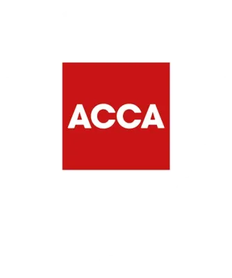
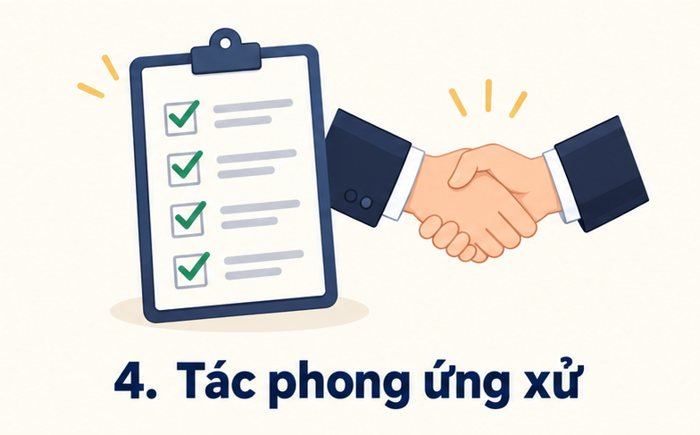
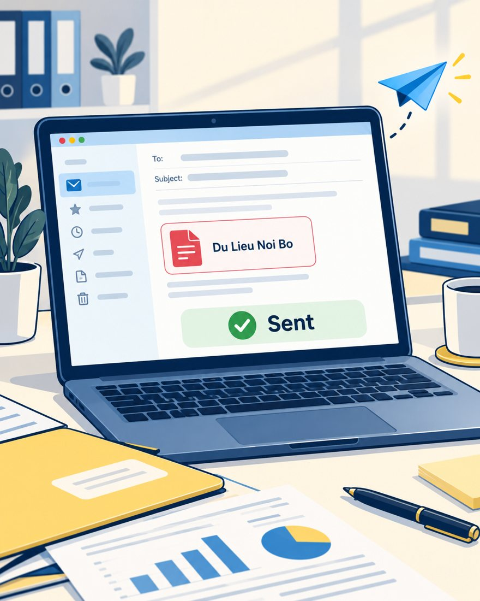

Kỹ năng mềm cho associate

Audit Simulation 2026 | Training 2

Tiến độ0/6 bài

★Mở đầu›

★Tổng quan buổi học

1Phần 1: Hình ảnh chuyên nghiệp›

1Ấn tượng đầu tiên2Một ngày tại văn phòng khách hàng

2Phần 2: Tình huống thực tế›

3Trao đổi với khách hàng4Xử lý số liệu và làm việc với team5Khi mọi việc không như kế hoạch

3Phần 3: Tổng kết›

65 điều ước gì mình biết sớm hơn

Trainer: chị Lê Phương Thảo  
BISC Training Center

☰Tổng quan buổi học

Audit Simulation 2026 | Training 2

# Kỹ năng mềm cho associate mới

40 phút cùng chị Lê Phương Thảo: cách xuất hiện, trao đổi và xử lý tình huống như một kiểm toán viên chuyên nghiệp.

Bắt đầu →

Lộ trình

## 6 block, 40 phút

1Ấn tượng đầu tiên2Một ngày tại khách hàng3Trao đổi với khách hàng4Số liệu và teamwork5Khi có sự cố65 điều nên biết

← Trước

Chưa cóTiếp theo →

Block 1: Ấn tượng đầu tiên

Copyright © BISC Training Center. Audit Simulation 2026, Training 2: Kỹ năng mềm

Block 1First impressions matter

# Ấn tượng đầu tiên

Mini survey

## Bốn điều tạo nên ấn tượng đầu tiên

Gọn gàng, chỉn chu, hợp môi trường làm việc.

Tư thế thẳng, ánh mắt và biểu cảm tập trung.

Chào rõ ràng, lắng nghe, chưa hiểu thì hỏi.

Tôn trọng thời gian, không gian và mọi người.

← Trước

Tổng quan buổi họcTiếp theo →

Block 2: Một ngày tại văn phòng khách hàng

Copyright © BISC Training Center. Audit Simulation 2026, Training 2: Kỹ năng mềm

Block 2Professional presence

# Một ngày tại văn phòng khách hàng

A day at a client site

## Một ngày làm việc qua 4 thời điểm

08:30

1

**Đến văn phòng**

- Đến sớm, mang đủ đồ cần thiết
- Chào hỏi, làm theo hướng dẫn

09:00

2

**Gặp khách hàng**

- Chào hỏi, giới thiệu ngắn gọn
- Lắng nghe, chưa rõ thì hỏi lại

10:00

3

**Trong giờ làm việc**

- Cập nhật tiến độ, báo sớm vướng mắc
- Giữ kín thông tin khách hàng

17:30

4

**Kết thúc ngày**

- Báo việc đã xong, việc còn tồn
- Dọn bàn, chốt việc ngày mai

Thời điểm tiếp theo ↓

← Trước

Block 1: Ấn tượng đầu tiênTiếp theo →

Block 3: Trao đổi với khách hàng

Copyright © BISC Training Center. Audit Simulation 2026, Training 2: Kỹ năng mềm

Block 3How you communicate with clients

# Trao đổi với khách hàng

Case study

## Hết on field nhưng vẫn thiếu chứng từ

Tình huống

Đã hết **3 tuần on field**. Bạn phát hiện vẫn cần **thêm chứng từ** từ khách hàng.

Bạn sẽ trao đổi và xin bổ sung thế nào?

Twist

## Nhưng mọi chuyện không đơn giản

?Twist 1Bấm để lật①Phía khách hàngĐang khóa sổ, bận nhiều việc

VS

?Twist 2Bấm để lật②Phía managerCần chốt số, gửi draft lên partner

Khách hàngManager

Lật cả hai thẻ để xem bạn đang bị kéo về hai phía nào

4 kỹ năng

## Bốn mảnh ghép để cân bằng

Bấm vào từng mảnh để ráp vào bảng **0/4**

📝**Yêu cầu rõ ràng**Cần gì, vì sao, hạn khi nào.

🔔**Theo dõi, nhắc việc**Nhắc đúng lúc, đúng kênh, lịch sự.

🤝**Xử lý phản đối**Lắng nghe lý do, giải thích mục đích.

📅**Thống nhất thời hạn**Chốt mốc cụ thể cả hai cùng làm được.

Cân bằng  
yêu cầu, tiến độ, quan hệ

Tháo ra ráp lại

← Trước

Block 2: Một ngày tại văn phòng khách hàngTiếp theo →

Block 4: Xử lý số liệu và làm việc với team

Copyright © BISC Training Center. Audit Simulation 2026, Training 2: Kỹ năng mềm

Block 4How you handle work & data

# Xử lý số liệu và làm việc với team

Case study

## Số không khớp, deadline thì gấp

Tình huống

Sổ chi tiết lệch với bảng cân đối kế toán:

Phải thu khách hàng**−1,2 tỷ**

Hàng tồn kho**+850 triệu**

Phải trả người bán**−430 triệu**

S

Senior · 16:02“1 tiếng nữa anh cần draft OARP để mai họp với khách hàng.”

Ưu tiên kiểm tra gì, phối hợp với ai, báo cáo ra sao?

Xử lý dữ liệu

## Bốn bước trọng tâm

01**Kiểm tra**Số liệu, nguồn, phép tính

02**Hiểu vấn đề**Bản chất, nguyên nhân lệch

03**Báo cáo**Báo sớm cho người phụ trách

04**Thống nhất**Hướng xử lý, phạm vi, hạn

Teaming

## Giao tiếp trong team

**Communication**Giao tiếp khi làm việc nhóm

👥**Với team**

Phối hợp xử lý, tránh dồn việc vào một vài người

🧑‍💼**Với senior**

Cập nhật sớm, tránh phút chót

← Trước

Block 3: Trao đổi với khách hàngTiếp theo →

Block 5: Khi mọi việc không như kế hoạch

Copyright © BISC Training Center. Audit Simulation 2026, Training 2: Kỹ năng mềm

Block 5When things go wrong

# Khi mọi việc không như kế hoạch

Rapid-fire

## Bốn tình huống, mỗi tình huống 1–2 phút

Điều đầu tiên em sẽ làm? Điều gì tuyệt đối không nên làm?

01MISTAKE

### Một sai sót ngoài ý muốn

The Mistake You Didn’t Mean to Make✓ Đã xem02DELAY

### Khi bạn không thể hoàn thành đúng hạn

When You Can’t Deliver on Time✓ Đã xem03PUSHBACK

### Khi khách hàng không đồng tình

When the Client Pushes Back✓ Đã xem04UNCERTAINTY

### Khi bạn chưa biết hướng xử lý

When You’re Stuck Without an Answer✓ Đã xem

Card 01 · MISTAKEThe Mistake You Didn’t Mean to Make

### Gửi sai file

Bạn vừa gửi email cho khách hàng nhưng phát hiện mình đính kèm nhầm **file working paper nội bộ** thay vì file dự kiến gửi. Email đã được gửi đi và bạn chưa biết khách hàng đã mở file hay chưa.

Bấm vào thẻ để xem cách xử lý ↻

Card 01 · MISTAKE

### Gửi sai file

**✓ DO · Nên làm**

- Báo ngay cho Senior, nêu rõ file đã gửi và người nhận.
- Phối hợp xử lý theo hướng dẫn: thu hồi email nếu có thể, liên hệ người nhận và gửi lại file đúng khi được thống nhất.

**✕ DON’T · Cần tránh**

- Im lặng, tự xử lý khi chưa thống nhất hoặc cố che giấu sai sót.

Card 02 · DELAYWhen You Can’t Deliver on Time

### Không kịp deadline

Bạn được giao hoàn thành một phần working paper trước cuối ngày. Tuy nhiên, dữ liệu khách hàng cung cấp **chưa đầy đủ**, một số số liệu chưa khớp và bạn nhận ra mình khó có thể hoàn thành đúng hạn.

Bấm vào thẻ để xem cách xử lý ↻

Card 02 · DELAY

### Không kịp deadline

**✓ DO · Nên làm**

- Báo Senior sớm, nêu rõ phần đã hoàn thành, vướng mắc và ảnh hưởng đến deadline.
- Đề xuất phương án: ưu tiên phần quan trọng, bổ sung dữ liệu còn thiếu hoặc thống nhất lại thời hạn.

**✕ DON’T · Cần tránh**

- Đợi đến sát giờ mới báo, im lặng làm tiếp hoặc đánh đổi chất lượng để kịp hạn.

Card 03 · PUSHBACKWhen the Client Pushes Back

### “Năm ngoái audit không hỏi”

Bạn yêu cầu khách hàng cung cấp thêm chứng từ để hoàn thành thủ tục kiểm toán. Khách hàng phản hồi: **“Năm ngoái audit không hỏi cái này, sao năm nay lại cần?”** và tỏ ra không hài lòng vì phải chuẩn bị thêm tài liệu.

Bấm vào thẻ để xem cách xử lý ↻

Card 03 · PUSHBACK

### “Năm ngoái audit không hỏi”

**✓ DO · Nên làm**

- Ghi nhận sự bất tiện và giải thích ngắn gọn mục đích của yêu cầu năm nay.
- Làm rõ tài liệu cần cung cấp; trao đổi với Senior nếu khách hàng tiếp tục phản đối.

**✕ DON’T · Cần tránh**

- Tranh luận, đổ lỗi cho quy trình hoặc tự ý bỏ qua yêu cầu kiểm toán.

Card 04 · UNCERTAINTYWhen You’re Stuck Without an Answer

### Senior chưa phản hồi

Bạn gặp một chênh lệch số liệu chưa hiểu rõ và cần xác nhận hướng xử lý. Bạn đã nhắn Senior nhưng **chưa nhận được phản hồi**, trong khi deadline đang đến gần và bạn vẫn còn những phần việc liên quan cần hoàn thành.

Bấm vào thẻ để xem cách xử lý ↻

Card 04 · UNCERTAINTY

### Senior chưa phản hồi

**✓ DO · Nên làm**

- Chủ động rà soát dữ liệu, hướng dẫn và tài liệu liên quan để hiểu rõ vấn đề trước.
- Linh hoạt tìm kiếm sự hỗ trợ khác.
- Trình bày rõ vướng mắc, những gì đã tìm hiểu và điểm cần xác nhận để nhận được hướng dẫn hiệu quả.

**✕ DON’T · Cần tránh**

- Đứng chờ hoàn toàn, chỉ phụ thuộc vào một người hoặc tự suy đoán khi chưa đủ cơ sở.
- Để vấn đề kéo dài mà không cập nhật tiến độ.

← Trước

Block 4: Xử lý số liệu và làm việc với teamTiếp theo →

Block 6: 5 điều ước gì mình biết sớm hơn

Copyright © BISC Training Center. Audit Simulation 2026, Training 2: Kỹ năng mềm

Block 65 things I wish I knew as an intern

# 5 điều ước gì mình biết sớm hơn

Mentor sharing

## Ghi vào sổ trước khi bắt đầu job

Key takeawaysAudit Simulation 2026

1.Tự tin thể hiện bản thân2.Trở thành người mọi người muốn làm việc cùng3.Suy nghĩ trước khi đặt câu hỏi4.Lên tiếng sớm khi gặp vấn đề5.Thấu hiểu người đối diện: senior, khách hàng

Tick vào điều bạn sẽ áp dụng ngay từ Client Day

← Trước

Block 5: Khi mọi việc không như kế hoạchTiếp theo →

Hoàn thành

Copyright © BISC Training Center. Audit Simulation 2026, Training 2: Kỹ năng mềm

🔊