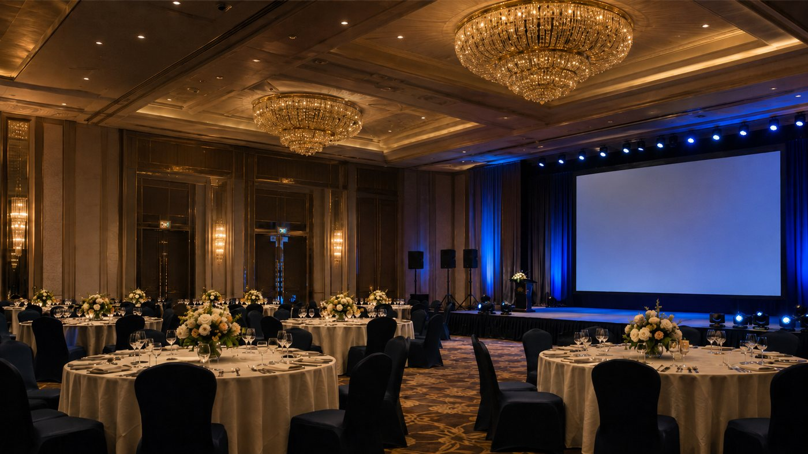

[**Audit Simulation 2026**](#top)

[Mô hình](#mo-hinh)
[Lưu trú](#luu-tru)
[Văn phòng](#van-phong)
[Sự kiện](#su-kien)
[Cạnh tranh](#canh-tranh)

[01 · Ngành](01-tong-quan-nganh-biscore-cadmus.html)[02 · Biscore](02-ho-so-biscore-cadmus.html)[03 · Yêu cầu](03-yeu-cau-cadmus.html)

# Tổng quan ngành

01◌

**Cho thuê văn phòng**

02↗

**Lưu trú khách sạn**

03◎

**Sự kiện & tiệc**

01 · Ba mô hình

## Ngành này trông như thế nào

🏢

**Cho thuê văn phòng***Building leasing*

- Doanh thu **theo hợp đồng và lặp lại**: khách thuê cam kết diện tích trong một thời hạn xác định
- Khách thuê trả **tiền thuê cơ bản** cùng phí dịch vụ và các khoản phí liên quan đến toà nhà
- Hiệu quả của mảng phụ thuộc vào thời hạn hợp đồng, diện tích đã cho thuê, **giá thuê thực**, ưu đãi và tỷ lệ giữ chân khách thuê

🛎️

**Lưu trú khách sạn***Hotel accommodation*

- Doanh thu từ **tồn kho dễ hỏng**: một đêm phòng không bán được thì không thể để dành sang ngày hôm sau
- Phòng được bán cho khách công ty, khách lẻ và khách đoàn qua **kênh trực tiếp và kênh trung gian**
- **Công suất, ADR** và cơ cấu kênh bán là ba biến số định hình doanh thu buồng phòng

🎉

**Sự kiện & tiệc***Events & banquet*

- Doanh thu theo **từng vụ việc** nhưng thường được đặt trước
- Một sự kiện có thể gộp **thuê mặt bằng, ăn uống, thiết bị nghe nhìn, trang trí** và các dịch vụ khác
- Loại hình sự kiện, số khách, giá trị gói, thời gian đặt trước và tiền cọc quyết định hồ sơ thương mại

02 · Doanh thu

## Doanh thu hình thành thế nào

**Lưu trú khách sạn***Hotel accommodation*

**Cho thuê văn phòng***Building leasing*

**Sự kiện & tiệc***Events & banquet*

03 · Lưu trú khách sạn

## Bán tồn kho phòng theo từng ngày

Mỗi ngày khách sạn có một số đêm phòng cố định. Doanh thu sinh ra từ việc bán số đêm phòng đó với các mức giá khác nhau cho từng phân khúc khách và từng kênh đặt phòng. Biscore Grand Hotel có 320 phòng, tương ứng 116.800 đêm phòng sẵn có trong năm 2025.

**Bước 01** mức khai thác

**Công suất phòng**Occupancy

**Số đêm phòng bán ra***Số đêm phòng sẵn có*

**Bước 02** giá bình quân

**Giá phòng bình quân**ADR — Average Daily Rate

**Doanh thu buồng phòng***Số đêm phòng bán ra*

**Bước 03** kết hợp cả hai

**Doanh thu trên phòng sẵn có**RevPAR

**Doanh thu buồng phòng***Số đêm phòng sẵn có*

### 3.1. Khách đặt phòng và lưu trú thế nào

**Thời gian đặt trước***% số lượt đặt phòng · thị trường tham chiếu · FY2025*

32%4 – 14 ngày

28%0 – 3 ngày

21%15 – 30 ngày

19%Trên 31 ngày

**Số đêm lưu trú***% số lượt lưu trú · thị trường tham chiếu · FY2025*

33%2 đêm

29%1 đêm

24%3 – 4 đêm

14%Từ 5 đêm

**Phân khúc khách lưu trú***thị trường tham chiếu · % đêm phòng · FY2025*

Khách công ty: 37%
Khách lẻ & du lịch: 63%
37%
63%

- Khách công ty37%
- Khách lẻ & du lịch63%

**Kênh đặt phòng***thị trường tham chiếu · % lượt đặt phòng · FY2025*

Hợp đồng doanh nghiệp: 31%
Sàn OTA: 30%
Đặt trực tiếp & kênh khác: 39%
31%
30%
39%

- Hợp đồng doanh nghiệp31%
- Sàn OTA30%
- Đặt trực tiếp & kênh khác39%

### 3.2. Chỉ số vận hành khách sạn theo tháng

**Công suất phòng và ADR theo tháng***thị trường tham chiếu và Biscore Grand Hotel · năm 2025*

**Công suất phòng**%

[sơ đồ SVG]

**Giá phòng bình quân — ADR**Triệu đồng / đêm phòng

[sơ đồ SVG]

Thị trường 2024
Thị trường 2025
Biscore Grand Hotel 2025
Rê chuột vào từng tháng để xem số liệu

| Tháng | T1 | T2 | T3 | T4 | T5 | T6 | T7 | T8 | T9 | T10 | T11 | T12 |
| --- | --- | --- | --- | --- | --- | --- | --- | --- | --- | --- | --- | --- |
| Công suất thị trường 2024 | 60 | 63 | 67 | 71 | 76 | 70 | 68 | 66 | 69 | 73 | 78 | 72 |
| Công suất thị trường 2025 | 62 | 65 | 69 | 73 | 76 | 72 | 70 | 68 | 71 | 74 | 79 | 73 |
| Công suất Biscore Grand Hotel 2025 | 68,7 | 67,4 | 74,7 | 71,7 | 60,9 | 58,2 | 55,7 | 59,4 | 66,7 | 74,4 | 77,5 | 92,4 |
| ADR thị trường 2024 | 1,74 | 1,76 | 1,78 | 1,80 | 1,85 | 1,82 | 1,80 | 1,79 | 1,83 | 1,87 | 1,92 | 1,89 |
| ADR thị trường 2025 | 1,82 | 1,84 | 1,86 | 1,88 | 1,94 | 1,91 | 1,89 | 1,88 | 1,92 | 1,96 | 2,02 | 1,98 |
| ADR Biscore Grand Hotel 2025 | 1,785 | 1,785 | 1,785 | 1,785 | 1,785 | 1,785 | 1,785 | 1,785 | 1,785 | 1,785 | 1,785 | 1,785 |

Công suất tính bằng %, ADR tính bằng triệu đồng mỗi đêm phòng. RevPAR = Công suất × ADR. Công suất cả năm của Biscore Grand Hotel là 69,0% — 80.591 trên 116.800 đêm phòng sẵn có.

04 · Cho thuê văn phòng

## Biến diện tích sàn thành doanh thu lặp lại

Chủ toà nhà khai thác diện tích sàn bằng cách cho khách thuê. Tiền thuê cơ bản thường được niêm yết theo mét vuông mỗi tháng, cộng thêm phí dịch vụ vận hành khu vực chung. Trông giữ xe, thu hộ tiện ích, biển hiệu và các dịch vụ toà nhà khác tạo thêm nguồn thu.

68%

Tỷ trọng tiền thuê cơ bản trong doanh thu mảng · thị trường tham chiếu

71%

Khách thuê lập hoá đơn trả trước theo tháng · thị trường tham chiếu

41%

Diện tích thuộc hợp đồng 3–5 năm · thị trường tham chiếu

### 4.1. Ai thuê văn phòng

**Diện tích theo ngành nghề khách thuê***thị trường tham chiếu · % diện tích đã cho thuê*

Dịch vụ chuyên môn: 23%
Thương mại & phân phối: 21%
Công nghệ: 18%
Ngành khác: 16%
Dịch vụ tài chính: 12%
Giáo dục & đào tạo: 10%

- Dịch vụ chuyên môn23%
- Thương mại & phân phối21%
- Công nghệ18%
- Ngành khác16%
- Dịch vụ tài chính12%
- Giáo dục & đào tạo10%

**Thời hạn hợp đồng thuê***thị trường tham chiếu · % diện tích đã cho thuê*

3 – 5 năm: 41%
1 – 3 năm: 38%
Trên 5 năm: 13%
Dưới 1 năm: 8%

- 3 – 5 năm41%
- 1 – 3 năm38%
- Trên 5 năm13%
- Dưới 1 năm8%

### 4.2. Chỉ số thị trường văn phòng 2022–2025

**Tổng nguồn cung**Nghìn m² sàn

Tổng nguồn cung văn phòng của thị trường tham chiếu từ 2022 đến 2025
Năm 2022 là 1.720; 2023 là 1.810; 2024 là 1.940; 2025 là 2.130 nghìn m².

1.7201.8101.9402.130
2022202320242025

**Tỷ lệ lấp đầy thị trường**%

Tỷ lệ lấp đầy văn phòng của thị trường tham chiếu từ 2022 đến 2025
Năm 2022 là 89,2%; 2023 là 88,4%; 2024 là 86,9%; 2025 là 84,6%.

89,2%88,4%86,9%84,6%
2022202320242025

| Năm | Tổng nguồn cung (nghìn m²) | Tỷ lệ lấp đầy | Giá thuê niêm yết BQ (USD/m²/tháng) | Kỳ miễn tiền thuê BQ (tháng) |
| --- | --- | --- | --- | --- |
| 2022 | 1.720 | 89,2% | 31,5 | 1,0 |
| 2023 | 1.810 | 88,4% | 31,2 | 1,2 |
| 2024 | 1.940 | 86,9% | 30,6 | 1,8 |
| 2025 | 2.130 | 84,6% | 29,7 | 2,4 |

05 · Sự kiện & tiệc

## Bán mặt bằng, ăn uống và dịch vụ quanh một ngày đã định

Một thương vụ sự kiện bắt đầu từ ngày tổ chức, yêu cầu về mặt bằng và số khách dự kiến. Đề xuất thương mại thường gộp thuê phòng tiệc hoặc phòng họp với ăn uống, thiết bị nghe nhìn, trang trí, nhân sự phục vụ và các dịch vụ khác.

### 5.1. Ai mua dịch vụ sự kiện

**Khách hàng và hình thức sự kiện***thị trường tham chiếu · FY2025*

**Sự kiện theo nhóm khách hàng***thị trường tham chiếu · % số sự kiện*

Doanh nghiệp: 38%
Cưới & gia đình: 27%
Tổ chức, hiệp hội: 14%
Agency sự kiện: 11%
Cá nhân & xã giao: 10%
38%
27%
14%
11%
10%

- Doanh nghiệp38%
- Cưới & gia đình27%
- Tổ chức, hiệp hội14%
- Agency sự kiện11%
- Cá nhân & xã giao10%

**Giá trị và thời gian đặt trước***bình quân một sự kiện · theo hình thức*

**Giá trị bình quân một sự kiện***triệu đồng*

Tiệc cưới**320**

Sự kiện doanh nghiệp**185**

Hội nghị, hội thảo**145**

Xã giao & khác**110**

**Thời gian đặt trước bình quân***ngày*

Tiệc cưới**90**

Sự kiện doanh nghiệp**42**

Hội nghị, hội thảo**30**

Xã giao & khác**24**

### 5.2. Hoạt động sự kiện theo quý

**Nhu cầu sự kiện của thị trường theo quý***Quý 1/2024 = 100**Cao điểm quý 4*

Chỉ số hoạt động sự kiện theo quý từ quý 1 năm 2024 đến quý 4 năm 2025
Chỉ số nhu cầu thị trường theo quý: 100, 108, 96, 124, 102, 110, 91, 118.

Q1 2024Q2 2024Q3 2024Q4 2024Q1 2025Q2 2025Q3 2025Q4 2025

Chỉ số nhu cầu sự kiện của thị trường tham chiếu

06 · Bản đồ cạnh tranh

## Ba mô hình, ba chuẩn so sánh

Nhóm tham chiếu gồm các đơn vị kết hợp hoạt động lưu trú và bất động sản thương mại theo những cách khác nhau. Phần dưới chỉ mô tả mô hình kinh doanh, tệp khách hàng và đặc điểm doanh thu.

Biscore Group

Property-led hybrid

🏙️

Biscore Group Property-led hybrid

Văn phòng thương mại kết hợp khách sạn và sự kiện.

Khách thuê doanh nghiệpKhách công tác & du lịchKhách sự kiện

NestStay Homes

Pure accommodation

🏡

NestStay Homes Pure accommodation

Danh mục homestay và căn hộ dịch vụ, không có bất động sản văn phòng.

Lưu trú ngắn ngàyLưu trú trung hạn

Crestview

Luxury hotel-led hybrid

👑

Crestview Luxury hotel-led hybrid

Hai khách sạn cao cấp và một toà văn phòng.

Khách sạn cao cấpKhách hàng doanh nghiệpKhách thuê văn phòng

### 6.1. Chỉ số tham chiếu cấp tập đoàn

| Đơn vị | Doanh thu thuần (tỷ đồng) | Tỷ lệ lấp đầy văn phòng | Công suất lưu trú | Biên EBITDA | AR days | Debt / EBITDA |
| --- | --- | --- | --- | --- | --- | --- |
| **Biscore Group** | 721 | 82% | 69% | 27% | 70 | 3,4x |
| NestStay Homes | 420 | — | 81% | 18% | 12 | 0,9x |
| Crestview | 850 | 91% | 77% | 23% | 38 | 2,5x |

Số liệu của Biscore Group lấy từ bộ dữ liệu FY2025 của cuộc thi; số liệu của hai đơn vị tham chiếu là dữ liệu khảo sát cấp tập đoàn. Các chỉ số vận hành **cấp tài sản** ở phần dưới sử dụng nhóm so sánh của từng loại tài sản.

### 6.2. Nhóm so sánh cấp tài sản

| Toà văn phòng | Hạng | Tỷ lệ lấp đầy | Giá thuê (USD/m²/tháng) | Kỳ miễn tiền thuê (tháng) |
| --- | --- | --- | --- | --- |
| **Biscore Group** — khối văn phòng | — | 82,0% | — | — |
| Metro Office | B+ | 90,8% | 25,5 | 1,5 |
| Horizon Tower | A | 88,7% | 31,0 | 2,0 |
| Capital Gate | A | 87,4% | 32,1 | 2,0 |
| Central Plaza | A | 85,9% | 30,1 | 2,5 |

| Khách sạn | Công suất phòng | ADR (triệu đồng) |
| --- | --- | --- |
| **Biscore Grand Hotel** | 69,0% | 1,785 |
| Grand Central | 77,0% | 2,32 |
| Meridian Hotel | 74,2% | 2,05 |
| Lakeview Grand | 71,4% | 1,94 |
| Capital Suites | 69,1% | 1,88 |

Nhóm so sánh được chọn theo phân khúc thị trường và định vị thương mại tương đương. Tỷ lệ lấp đầy, công suất phòng và ADR của Biscore Group lấy từ bộ dữ liệu FY2025; số liệu của các đơn vị còn lại là dữ liệu khảo sát thị trường. Bộ dữ liệu không có giá thuê niêm yết và kỳ miễn tiền thuê của Biscore Group nên hai cột này để trống.

07 · Bối cảnh thị trường

## Bối cảnh 2025 – 2026

Bốn chủ đề thương mại chi phối cả ba mảng: bất động sản, lưu trú và sự kiện. Mọi con số trong phần này lấy từ thị trường tham chiếu đã trình bày ở các mục 03 – 05, không phải số liệu của Biscore Group.

**Cho thuê văn phòng***Office leasing*
01

Chu kỳ hiện tại nghiêng về phía khách thuê: nguồn cung mới ra liên tục trong khi tốc độ hấp thụ chậm lại.

- **Nguồn cung tăng 23,8% trong bốn năm** — từ 1.720 lên 2.130 nghìn m² sàn — trong khi tỷ lệ lấp đầy giảm đều từ 89,2% xuống 84,6%. Bốn năm liên tiếp cùng một chiều, không phải biến động nhất thời.
- **Cạnh tranh dịch chuyển từ giá sang ưu đãi.** Giá niêm yết chỉ giảm 5,7% (31,5 → 29,7 USD/m²/tháng), nhưng kỳ miễn tiền thuê bình quân tăng từ 1,0 lên 2,4 tháng — riêng khoản này đã lấy đi thêm gần 12% doanh thu của năm hợp đồng đầu tiên.
- **Giá niêm yết không phải giá thực.** Sau khi trừ kỳ miễn tiền thuê, hỗ trợ thi công nội thất và các ưu đãi đã đàm phán, giá thuê thực thấp hơn đáng kể so với con số công bố.
- **Danh mục khách thuê phân tán.** Ngành có tỷ trọng lớn nhất — dịch vụ chuyên môn — cũng chỉ chiếm 23% diện tích. 41% diện tích nằm trong hợp đồng 3–5 năm và 38% trong hợp đồng 1–3 năm, nên lịch đáo hạn trải đều từ nửa đầu 2026 đến 2028 chứ không dồn vào một mốc.

**Vì sao quan trọng**Doanh thu cho thuê ghi nhận theo phương pháp đường thẳng suốt thời hạn hợp đồng. Ưu đãi, phụ lục điều chỉnh diện tích và tiền thu trước đều làm doanh thu ghi nhận lệch khỏi dòng tiền thực thu.

**Nhu cầu lưu trú***Hotel demand*
02

Cầu lưu trú do công tác doanh nghiệp, du lịch, khách đoàn và lịch sự kiện cùng dẫn dắt, biến động theo mùa rõ rệt.

- **Công suất thị trường cải thiện nhẹ giữa hai năm:** bình quân 71,0% năm 2025 so với 69,4% năm 2024. Trong năm, khoảng cách giữa tháng cao nhất (79% — tháng 11) và thấp nhất (62% — tháng 1) là 17 điểm phần trăm.
- **Giá phòng là biến số thứ hai.** ADR thị trường dao động 1,82–2,02 triệu đồng mỗi đêm, đỉnh cũng rơi vào tháng 11. Vì RevPAR = công suất × ADR, một khách sạn có thể giữ doanh thu bằng cách hy sinh giá để lấp phòng, hoặc ngược lại.
- **Kênh phân phối quyết định phần lớn nguồn khách:** hợp đồng doanh nghiệp 31%, sàn OTA 30%, đặt trực tiếp và kênh khác 39%. Riêng khách công ty chiếm 37% số đêm phòng bán ra.
- **Tầm nhìn đặt phòng rất ngắn.** 60% lượt đặt phòng phát sinh trong vòng 14 ngày trước ngày nhận phòng, và 62% lượt lưu trú chỉ kéo dài 1–2 đêm. Doanh thu tháng sau gần như không thể chốt trước từ đầu tháng.

**Vì sao quan trọng**Đêm phòng là hàng tồn kho hết hạn theo ngày — bán không được thì mất hẳn. Doanh thu chạy qua hệ thống PMS rồi mới sang phần mềm kế toán, nên ranh giới ngày nhận và trả phòng là nơi số liệu dễ lệch nhất.

**Sự kiện & MICE***Events & MICE*
03

Mảng có tính mùa vụ mạnh nhất trong ba mảng, và giá trị mỗi hợp đồng chênh lệch rất lớn.

- **Cao điểm dồn vào quý 4.** Chỉ số nhu cầu thị trường đạt 124 điểm ở quý 4/2024 và 118 điểm ở quý 4/2025, so với đáy 91 điểm ở quý 3/2025 — biên độ giữa quý cao nhất và thấp nhất lên tới 36%.
- **Ba nguồn cầu riêng biệt, không thay thế nhau:** doanh nghiệp 38% số sự kiện, cưới và gia đình 27%, tổ chức – hiệp hội 14%; phần còn lại là agency sự kiện 11% và cá nhân 10%.
- **Giá trị mỗi sự kiện chênh nhau gần ba lần:** tiệc cưới bình quân 320 triệu đồng, sự kiện doanh nghiệp 185 triệu, hội nghị – hội thảo 145 triệu, xã giao và khác 110 triệu.
- **Thời gian đặt trước tỷ lệ thuận với quy mô:** tiệc cưới đặt trước bình quân 90 ngày, sự kiện doanh nghiệp 42 ngày, hội nghị 30 ngày, còn các cuộc họp nhỏ chỉ 24 ngày — có thể chốt sát ngày tổ chức.

**Vì sao quan trọng**Một thương vụ sự kiện xoay quanh đúng một ngày đã định, với gói dịch vụ tuỳ biến theo từng hợp đồng. Hợp đồng, banquet event order và biên bản nghiệm thu là ba mốc xác định thời điểm và giá trị doanh thu.

**Môi trường chi phí***Cost environment*
04

Cả hai mảng đều có tỷ trọng chi phí cố định cao, nên biên lợi nhuận rất nhạy với mức khai thác.

- **Nền chi phí lớn và ít co giãn.** Nhân sự, điện nước, bảo trì, dịch vụ thuê ngoài và giá vốn ăn uống phát sinh gần như không đổi dù công suất phòng hay tỷ lệ lấp đầy thay đổi trong biên độ thông thường.
- **Đòn bẩy hoạt động cao.** Vì phần lớn chi phí đã cố định, mỗi điểm phần trăm công suất hoặc lấp đầy tăng thêm gần như chảy thẳng xuống lợi nhuận — và chiều ngược lại cũng đúng như vậy.
- **Chính sách giá không tách rời nền chi phí.** Hạ giá để giữ khách thuê hoặc lấp phòng chỉ có ý nghĩa khi phần doanh thu tăng thêm còn bù được chi phí biến đổi đi kèm.
- **So sánh biên lợi nhuận phải xét cùng mức khai thác.** Hai đơn vị có cùng biên EBITDA nhưng khác công suất, khác ADR hoặc khác cơ cấu tài sản thì không nói lên cùng một điều.

**Vì sao quan trọng**Đây là đặc điểm chung của cả đơn vị bất động sản lẫn đơn vị lưu trú. Khi biên lợi nhuận thay đổi mạnh mà mức khai thác gần như đứng yên, phần chênh đó phải giải thích được bằng chi phí hoặc bằng chính sách ghi nhận.

[Tài liệu 02 — Hồ sơ Công ty CP Biscore Group →](02-ho-so-biscore-cadmus.html)

[**Audit Simulation 2026**](#d2top)

[Giới thiệu](#p1)[Tài chính](#p2)[Doanh nghiệp](#p3)[Vận hành](#p4)[Sự kiện](#p5)[Phụ lục](#p6)

[01 · Ngành](01-tong-quan-nganh-biscore-cadmus.html)[02 · Biscore](02-ho-so-biscore-cadmus.html)[03 · Yêu cầu](03-yeu-cau-cadmus.html)

# BISCORE

Hồ sơ BISCORE GROUP - Đối tượng kiểm toán

Tài liệu 02 · Company profile

## Mục lục chi tiết

Từ hồ sơ pháp nhân, hai dòng kinh doanh và mô hình doanh thu, đến báo cáo tài chính FY2025, chỉ số vận hành khách sạn, sự kiện trong năm và hệ thống kiểm soát nội bộ theo chu trình.

### 01 Hồ sơ doanh nghiệp

1. [Thông tin chung**01.01**](#company-overview)
2. [Lịch sử phát triển**01.02**](#company-history)
3. [Hai dòng kinh doanh**01.03**](#assets)

### 02 Tài chính & vận hành

1. [Báo cáo tài chính FY2025**02.01**](#financial-summary)
2. [Công nợ phải thu và phải trả**02.02**](#working-capital)
3. [Chỉ số vận hành khách sạn**02.03**](#hotel-kpi)
4. [Chỉ số vận hành toà văn phòng**02.04**](#office-kpi)

### 03 Doanh nghiệp & mô hình kinh doanh

1. [Cơ cấu cổ đông**03.01**](#ownership-structure)
2. [Cấu trúc pháp nhân và hai dòng kinh doanh**03.02**](#group-structure)
3. [HĐQT và Ban điều hành**03.03**](#directors)
4. [Bộ máy tài chính – kế toán**03.04**](#key-management)
5. [Hai dòng doanh thu, hai cách ghi sổ**03.05**](#revenue-model)
6. [Danh mục khách thuê**03.06**](#tenant-base)
7. [Cấu phần dịch vụ khách sạn**03.07**](#hotel-model)
8. [Mảng hội nghị, tiệc và sự kiện**03.08**](#event-business)
9. [Quy trình các khoản mục khác**03.09**](#process-cycles)

### 04 Bối cảnh & vận hành

1. [Môi trường kinh doanh**04.01**](#business-environment)
2. [Yếu tố kinh doanh trong năm**04.02**](#business-risks)
3. [Tôn chỉ, tầm nhìn và giá trị cốt lõi**04.03**](#purpose-values)
4. [Chiến lược & môi trường kiểm soát**04.04**](#strategy-control)
5. [11 nhóm hoạt động trọng yếu**04.05**](#business-operations)

### 05 Sự kiện & phụ lục

1. [Sự kiện và cột mốc FY2025**05.01**](#milestones)
2. [Phụ lục · Bộ dữ liệu phát cho thí sinh**A.01**](#appendix-data)

Phần 01

## Giới thiệu chung & Tóm tắt điều hành

1.1

## Về chúng tôi

Công ty Cổ phần Biscore Group vận hành hai dòng kinh doanh tại Hà Nội: toà văn phòng cho thuê Biscore Tower và khách sạn 4 sao 320 phòng Biscore Grand Hotel. Toàn bộ doanh thu FY2025 đến từ dịch vụ, không có hoạt động sản xuất hay thương mại hàng hoá.

| Chỉ tiêu | Thông tin |
| --- | --- |
| Tên đầy đủ | Công ty Cổ phần Biscore Group (*Biscore Group Joint Stock Company*) |
| Loại hình | Công ty cổ phần chưa niêm yết |
| Trụ sở chính | Số 68 đường Phạm Hùng, phường Mễ Trì, quận Nam Từ Liêm, Hà Nội |
| Ngành nghề chính | Cho thuê văn phòng và cung cấp dịch vụ toà nhà · Kinh doanh khách sạn, ăn uống, hội nghị và sự kiện |
| **Hai dòng kinh doanh** | **01 · Biscore Tower** — cho thuê văn phòng, tháp A và tháp B, 63 khách thuê đang hoạt động, 37.280 m² theo danh mục hợp đồng **02 · Biscore Grand Hotel** — khách sạn 4 sao 320 phòng, F&B, hội nghị và sự kiện |
| Vốn góp của chủ sở hữu | 500.000.000.000 đồng |
| Kỳ kế toán | Năm tài chính 2025: từ 01/01/2025 đến 31/12/2025 |
| Khung kế toán áp dụng | Chuẩn mực Kế toán Việt Nam (VAS) và Thông tư 200/2014/TT-BTC |
| Đơn vị tiền tệ kế toán | Đồng Việt Nam (VND) |
| Thuế giá trị gia tăng | Phương pháp khấu trừ · thuế suất đầu ra 10% cho cả hai mảng |
| Bộ phận theo dõi trên sổ | OFA = Biscore Tower và HTL = Biscore Grand Hotel là hai dòng kinh doanh · COR = Corporate là bộ phận cấp công ty, không phải dòng kinh doanh thứ ba |
| Phạm vi kiểm toán mô phỏng | Doanh thu · Phải thu khách hàng · Phải trả người bán · Chi phí trả trước · Tài sản cố định · Vay và lãi vay |

1.2

## Lịch sử phát triển

**2011**Thành lập

**2014**Khai thác tháp A

**2017**Mở rộng tháp B

**2019**Khai trương  
khách sạn

**2020 – 2022**Công suất thấp

**2023**Phục hồi lưu trú

**2024**Doanh thu 657,7 tỷ

**2025**Doanh thu 721,2 tỷ

Kéo ngang để xem toàn bộ chặng đường →

1.3

## Hai dòng kinh doanh

#### Biscore Tower

#### Biscore Grand Hotel

| Tiêu chí | Dòng 01 — Biscore Tower | Dòng 02 — Biscore Grand Hotel |
| --- | --- | --- |
| Mã bộ phận trên sổ | OFA | HTL |
| Dòng doanh thu | 5113.OF cho thuê · 5113.SC phí dịch vụ · 5113.PK trông giữ xe | 5113.RM buồng phòng · 5113.FB ăn uống · 5113.EV sự kiện · 5113.OT dịch vụ khác |
| Doanh thu FY2025 | 341.859.502.727 đồng | 379.925.297.273 đồng |
| Tệp khách hàng | 63 khách thuê là tổ chức, hợp đồng nhiều năm | Khách lẻ, khách đoàn, khách công ty và khách sự kiện |
| Nhịp lập hóa đơn | Hóa đơn HDO theo tháng, phát hành đầu tháng cho từng khách thuê | Hóa đơn HDK theo folio khi khách trả phòng · HDE theo từng sự kiện |
| Điều khoản thanh toán | 15 ngày kể từ ngày hóa đơn | Khách lẻ thanh toán ngay · khách công ty và sự kiện 30 ngày |
| Đặt cọc, ký quỹ | Tiền cọc khách thuê theo dõi trên TK 344, số dư 33.622.400.000 đ | Đặt cọc sự kiện theo hợp đồng từng vụ việc |
| Hệ thống nguồn | Bảng theo dõi hợp đồng thuê (rent roll) và phần mềm kế toán | Hệ thống PMS, kết xuất qua interface vào phần mềm kế toán |

Phần 02

## Chỉ tiêu tài chính & chỉ số hiệu quả trọng yếu

2.1

## Báo cáo tài chính FY2025 (chưa kiểm toán)

### 2.1.1. Kết quả hoạt động kinh doanh (đơn vị: đồng)

| Mã số | Chỉ tiêu | Năm 2025 | Năm 2024 | +/- % |
| --- | --- | --- | --- | --- |
| 01 | Doanh thu cung cấp dịch vụ | 724.784.800.000 | 658.000.000.000 | +10,1% |
| 02 | Các khoản giảm trừ doanh thu | (3.558.500.000) | (340.000.000) | +946,6% |
| 10 | Doanh thu thuần về cung cấp dịch vụ | 721.226.300.000 | 657.660.000.000 | +9,7% |
| 11 | Giá vốn dịch vụ cung cấp | (444.000.000.000) | (430.919.000.000) | +3,0% |
| 20 | Lợi nhuận gộp | 277.226.300.000 | 226.741.000.000 | +22,3% |
| 21 | Doanh thu hoạt động tài chính | 2.582.000.000 | 2.000.000.000 | +29,1% |
| 22 | Chi phí tài chính (chủ yếu là lãi vay) | (59.325.263.000) | (56.000.000.000) | +5,9% |
| 25 | Chi phí bán hàng | (57.999.997.000) | (56.291.000.000) | +3,0% |
| 26 | Chi phí quản lý doanh nghiệp | (109.850.011.000) | (105.790.000.000) | +3,8% |
| 30 | Lợi nhuận thuần từ hoạt động kinh doanh | 52.633.029.000 | 10.660.000.000 | +393,7% |
| 31 | Thu nhập khác | 1.800.000.000 | 1.500.000.000 | +20,0% |
| 32 | Chi phí khác | (900.000.000) | (800.000.000) | +12,5% |
| 50 | Tổng lợi nhuận kế toán trước thuế | 53.533.029.000 | 11.360.000.000 | +371,2% |
| 51 | Chi phí thuế TNDN hiện hành | (10.731.746.000) | (2.340.000.000) | +358,6% |
| 60 | Lợi nhuận sau thuế thu nhập doanh nghiệp | 42.801.283.000 | 9.020.000.000 | +374,5% |

### 2.1.2. Bảng cân đối kế toán (đơn vị: đồng)

| Chỉ tiêu | 31/12/2025 | 31/12/2024 | +/- % |
| --- | --- | --- | --- |
| **TÀI SẢN NGẮN HẠN** | 206.578.288.137 | 218.820.000.000 | -5,6% |
| Tiền và các khoản tương đương tiền | 48.190.882.137 | 71.920.000.000 | -33,0% |
| Phải thu khách hàng | 137.499.526.000 | 118.000.000.000 | +16,5% |
| Dự phòng phải thu khó đòi | (2.650.000.000) | (4.500.000.000) | -41,1% |
| Thuế GTGT được khấu trừ | — | 2.800.000.000 | -100,0% |
| Phải thu khác và tạm ứng | 5.987.880.000 | 4.600.000.000 | +30,2% |
| Chi phí trả trước | 17.550.000.000 | 26.000.000.000 | -32,5% |
| **TÀI SẢN DÀI HẠN** | 1.262.178.332.000 | 1.268.000.000.000 | -0,5% |
| Nguyên giá tài sản cố định hữu hình | 1.632.050.000.000 | 1.600.000.000.000 | +2,0% |
| Hao mòn lũy kế tài sản cố định hữu hình | (435.021.668.000) | (350.000.000.000) | +24,3% |
| Xây dựng cơ bản dở dang | 65.150.000.000 | 18.000.000.000 | +261,9% |
| TỔNG TÀI SẢN | 1.468.756.620.137 | 1.486.820.000.000 | -1,2% |
| **NỢ PHẢI TRẢ** | 805.955.337.137 | 806.820.000.000 | -0,1% |
| Phải trả người bán (thuần) | 45.040.297.137 | 82.000.000.000 | -45,1% |
| Thuế và các khoản phải nộp Nhà nước | 3.630.607.000 | 8.220.000.000 | -55,8% |
| Phải trả người lao động và các khoản trích theo lương | 13.462.033.000 | 11.200.000.000 | +20,2% |
| Chi phí phải trả | 26.000.000.000 | 26.000.000.000 | 0,0% |
| Doanh thu chưa thực hiện | 17.800.000.000 | 22.000.000.000 | -19,1% |
| Phải trả, phải nộp khác | 6.400.000.000 | 6.400.000.000 | 0,0% |
| Nhận ký quỹ, ký cược (tiền cọc khách thuê) | 33.622.400.000 | 31.000.000.000 | +8,5% |
| Vay ngắn hạn | 40.000.000.000 | — | — |
| Vay dài hạn | 620.000.000.000 | 620.000.000.000 | 0,0% |
| **VỐN CHỦ SỞ HỮU** | 662.801.283.000 | 680.000.000.000 | -2,5% |
| Vốn góp của chủ sở hữu | 500.000.000.000 | 500.000.000.000 | 0,0% |
| Lợi nhuận sau thuế chưa phân phối năm trước | 120.000.000.000 | 180.000.000.000 | -33,3% |
| Lợi nhuận sau thuế chưa phân phối năm nay | 42.801.283.000 | — | — |
| TỔNG NGUỒN VỐN | 1.468.756.620.137 | 1.486.820.000.000 | -1,2% |

2.2

## Công nợ phải thu và phải trả

### 2.2.1. Phải thu khách hàng tại 31/12/2025

| Tiểu khoản | Nội dung | Số dư đầu kỳ | Số dư cuối kỳ |
| --- | --- | --- | --- |
| 131.OF | Khách thuê văn phòng | 52.000.000.000 | 69.150.830.000 |
| 131.EV | Hội nghị, tiệc, sự kiện | 11.000.000.000 | 28.316.548.300 |
| 131.HT | Khách sạn (guest & city ledger) | 38.000.000.000 | 26.288.719.700 |
| 131.OT | Khác | 3.000.000.000 | 7.300.000.000 |
| 131.SC | Phí dịch vụ toà nhà | 14.000.000.000 | 6.443.428.000 |
| Cộng phải thu khách hàng | | 118.000.000.000 | 137.499.526.000 |
| 2293 | Dự phòng phải thu khó đòi | (4.500.000.000) | (2.650.000.000) |

| Nhóm tuổi nợ tại 31/12/2025 | Giá trị | Tỷ trọng |
| --- | --- | --- |
| Chưa đến hạn | 35.369.261.050 | 25,7% |
| Quá hạn 1 – 30 ngày | 45.861.955.795 | 33,4% |
| Quá hạn 31 – 90 ngày | 43.792.186.097 | 31,8% |
| Quá hạn 91 – 180 ngày | 4.206.365.335 | 3,1% |
| Quá hạn 181 – 365 ngày | 2.969.757.723 | 2,2% |
| Quá hạn trên 365 ngày | 5.300.000.000 | 3,9% |
| Tổng cộng — 98 khách hàng, 1.281 hóa đơn còn chưa thu | 137.499.526.000 | 100,0% |

### 2.2.2. Phải trả người bán tại 31/12/2025

| Tiểu khoản | Nhóm hàng hoá, dịch vụ | Số dư cuối kỳ |
| --- | --- | --- |
| 331.SRV | Dịch vụ vận hành, bảo trì | 15.475.682.138 |
| 331.OTH | Khác | 10.783.720.600 |
| 331.FNB | Thực phẩm, đồ uống | 10.257.835.399 |
| 331.MKT | Marketing, OTA, hoa hồng | 5.748.470.200 |
| 331.UTL | Điện, nước, nhiên liệu | 2.503.923.400 |
| 331.CON | Nhà thầu xây lắp, sửa chữa | 386.315.700 |
| 331.SUP | Vật tư, amenities, văn phòng phẩm (số dư Nợ) | (115.650.300) |
| Cộng phải trả người bán (thuần) — 64 nhà cung cấp | | 45.040.297.137 |

2.3

## Chỉ số vận hành khách sạn

Biscore Grand Hotel có 320 phòng, tương ứng 116.800 đêm phòng sẵn có trong năm 2025. Ba chỉ số chuẩn của ngành lưu trú là công suất phòng, giá phòng bình quân (ADR) và doanh thu trên mỗi phòng sẵn có (RevPAR).

Số phòng**320***Khách sạn 4 sao*

Đêm phòng sẵn có**116.800***320 phòng × 365 ngày*

Đêm phòng bán ra**80.591***Cả năm 2025*

Công suất phòng**69,0%***80.591 / 116.800*

ADR**1.785.000 đ***Giá phòng bình quân*

RevPAR**1.231.629 đ***Doanh thu buồng / phòng sẵn có*

| Chỉ tiêu | T1 | T2 | T3 | T4 | T5 | T6 | T7 | T8 | T9 | T10 | T11 | T12 |
| --- | --- | --- | --- | --- | --- | --- | --- | --- | --- | --- | --- | --- |
| Đêm phòng sẵn có | 9.920 | 8.960 | 9.920 | 9.600 | 9.920 | 9.600 | 9.920 | 9.920 | 9.600 | 9.920 | 9.600 | 9.920 |
| Đêm phòng bán ra | 6.813 | 6.043 | 7.413 | 6.879 | 6.038 | 5.588 | 5.528 | 5.896 | 6.404 | 7.376 | 7.443 | 9.169 |
| Công suất phòng | 68,7% | 67,4% | 74,7% | 71,7% | 60,9% | 58,2% | 55,7% | 59,4% | 66,7% | 74,4% | 77,5% | 92,4% |
| RevPAR (nghìn đ) | 1.226 | 1.204 | 1.334 | 1.279 | 1.087 | 1.039 | 995 | 1.061 | 1.191 | 1.327 | 1.384 | 1.650 |

Công suất phòng theo tháng — FY2025

Đơn vị: %. Giá phòng bình quân giữ nguyên 1.785.000 đồng suốt cả năm. Di chuột lên biểu đồ để xem từng tháng.

[sơ đồ SVG]

2.4

## Chỉ số vận hành toà văn phòng

Số khách thuê**63***Đang thuê tại 31/12/2025*

Diện tích hợp đồng**37.280 m²***Tổng của 63 khách thuê đang hoạt động*

Đơn giá thuê**515 – 700 nghìn***đồng/m²/tháng theo hợp đồng*

Đơn giá bình quân**≈ 585 nghìn***đồng/m²/tháng*

Tiền cọc khách thuê**33,6 tỷ***Số dư TK 344 tại 31/12/2025*

Doanh thu chưa thực hiện**17,8 tỷ***Số dư TK 3387 tại 31/12/2025*

Doanh thu khối văn phòng — FY2025 so với FY2024

Đơn vị: tỷ đồng. Thanh đậm là FY2025, thanh nhạt là FY2024.

FY2025FY2024

**Tiền thuê văn phòng**5113.OF*+10,8%*

*266,01*

*240,00*

**Phí dịch vụ toà nhà**5113.SC*+11,1%*

*58,91*

*53,00*

**Trông giữ xe**5113.PK*+5,9%*

*16,94*

*16,00*

Doanh thu cho thuê được ghi nhận theo phương pháp đường thẳng trong thời hạn hợp đồng. Với các hợp đồng có kỳ miễn tiền thuê hoặc thu tiền trước nhiều kỳ, phần chênh lệch giữa số tiền thu và số doanh thu ghi nhận được theo dõi trên tài khoản 3387 — doanh thu chưa thực hiện.

Phần 03

## Về doanh nghiệp & mô hình kinh doanh

3.1

## Cơ cấu cổ đông

**500,0 tỷ đồng** vốn góp của chủ sở hữu

#### Nhóm cổ đông sáng lập

Cổ đông kiểm soát · đề cử đa số thành viên Hội đồng quản trị

76,0%

#### Cổ đông tổ chức

Các tổ chức tham gia góp vốn trong các đợt tăng vốn

16,0%

#### Cổ đông cá nhân khác

Các cá nhân nắm giữ tỷ lệ nhỏ

8,0%

3.2

## Cấu trúc pháp nhân và hai dòng kinh doanh

Biscore Group là một pháp nhân duy nhất với đúng hai dòng kinh doanh. Công ty không sở hữu công ty con và không lập báo cáo tài chính hợp nhất.

**CÔNG TY CỔ PHẦN BISCORE GROUP**Pháp nhân duy nhất · đối tượng kiểm toán FY2025

Dòng kinh doanh 01

#### Biscore Tower

SEGMENT OFA

Cho thuê văn phòng tháp A và tháp B, kèm dịch vụ toà nhà và trông giữ xe. Doanh thu FY2025: 341.859.502.727 đồng.

Dòng kinh doanh 02

#### Biscore Grand Hotel

SEGMENT HTL

Khách sạn 4 sao 320 phòng: buồng phòng, ăn uống, hội nghị – tiệc – sự kiện và dịch vụ khác. Doanh thu FY2025: 379.925.297.273 đồng.

Hai dòng kinh doanh là **hai bộ phận hạch toán bên trong cùng một pháp nhân**, không phải công ty con và không hợp nhất báo cáo tài chính. Bộ phận Corporate (COR) chỉ ghi nhận các khoản ở cấp công ty, không phải dòng kinh doanh thứ ba.

3.3

## Hội đồng quản trị & Ban điều hành

**Sơ đồ quản trị và điều hành FY2025**Từ Đại hội đồng cổ đông xuống sáu khối chức năng · tên nhân sự dùng thống nhất với chứng từ trong bộ dữ liệu

Cấp sở hữu
Đại hội đồng cổ đông
Vốn góp 500,0 tỷ đồng · sáng lập 76% · tổ chức 16% · cá nhân khác 8%

Hội đồng quản trị · 05 thành viên
Nguyễn Đức Bình — Chủ tịch HĐQT
Đại diện nhóm cổ đông sáng lập. Phê duyệt kế hoạch kinh doanh năm, các khoản đầu tư lớn và điều kiện vay vốn.

*Trần Quốc Khánh — Phó Chủ tịch, phụ trách đầu tư và dự án cải tạo*
*Đặng Thu Trang — Thành viên, đại diện nhóm cổ đông tổ chức*
*Lê Minh Sơn — Thành viên độc lập, nền tảng tài chính ngân hàng*
*Phạm Anh Tuấn — Thành viên, phụ trách quan hệ khách thuê lớn*

Ban Kiểm soát · 03 thành viên
Ngô Thị Bích Hằng — Trưởng ban
Hoạt động theo Điều lệ, báo cáo trực tiếp Đại hội đồng cổ đông. FY2025 công ty chưa có bộ phận kiểm toán nội bộ độc lập.
KHÔNG TRỰC THUỘC BAN GIÁM ĐỐC

Ban Giám đốc
Lê Hoàng Nam — Tổng Giám đốc
Điều hành chung hai dòng kinh doanh, ký hợp đồng thuê và hợp đồng sự kiện lớn, phê duyệt các khoản chi vượt hạn mức của Giám đốc Tài chính.

Khối OFA
Nguyễn Việt Hưng
Giám đốc khối Biscore Tower

*Hợp đồng thuê, phụ lục và rent roll*
*Phí dịch vụ toà nhà, trông giữ xe*
*Vận hành kỹ thuật tháp A và tháp B*

Khối HTL
Đỗ Quang Huy
Giám đốc khối Biscore Grand Hotel

*Buồng phòng, F&B và banquet*
*Night audit và hệ thống PMS*
*Chất lượng dịch vụ 320 phòng*

Khối Tài chính
Hoàng Thế Vinh
Giám đốc Tài chính · `hoang.tv.cfo`

*Ngân quỹ, quan hệ bốn ngân hàng*
*Phê duyệt thanh toán theo hạn mức*
*Kế toán trưởng Vũ Đăng Quang trực thuộc*

Khối Kinh doanh
Phạm Thùy Dương
Giám đốc Kinh doanh & Marketing

*Cho thuê văn phòng và gia hạn*
*Kênh OTA, đại lý và khách đoàn*
*Bộ phận Tiệc lập nhật ký sự kiện*

Khối Nhân sự
Vũ Thị Kim Oanh
Giám đốc Nhân sự – Hành chính

*Quỹ lương FY2025 128,03 tỷ đồng*
*Ca kíp khách sạn, nhân sự thời vụ*
*Bảo hiểm và các khoản trích theo lương*

Khối Kỹ thuật
Trịnh Văn Đạt
Giám đốc Kỹ thuật – Dự án

*Ban quản lý dự án cải tạo*
*Xây dựng cơ bản dở dang 65,15 tỷ*
*Nghiệm thu nhà thầu xây lắp*

**Nét liền** — quan hệ báo cáo trực tiếp
**Nét đứt** — quan hệ giám sát, không điều hành
**OFA · HTL** — hai mã bộ phận trên sổ cái

3.4

## Bộ máy tài chính – kế toán

Bộ phận kế toán gồm tám vị trí: hai cấp phê duyệt và sáu phần hành ghi sổ. Mỗi bút toán trên sổ cái đều mang tên người lập và tài khoản người dùng tương ứng.

**Tuyến phân quyền của bộ phận kế toán**Tám phần hành, mỗi phần hành do một vị trí phụ trách · sổ cái ghi nhận người lập theo tài khoản người dùng

Cấp phê duyệt tài chính
Giám đốc Tài chính
Ngân quỹ, quan hệ tín dụng với bốn ngân hàng, phê duyệt thanh toán theo hạn mức và soát xét cuối cùng báo cáo tài chính.

Cấp phê duyệt kế toán
Kế toán trưởng
Chính sách kế toán, quy trình khóa sổ, phê duyệt bút toán kế toán tổng hợp và bút toán kết chuyển cuối kỳ.

General ledger
Kế toán tổng hợp

*Bút toán tổng hợp và kết chuyển*
*Phân bổ chi phí trả trước TK 242*
*Phân bổ doanh thu chưa thực hiện*
*Lập bảng cân đối số phát sinh*

Accounts receivable
Kế toán công nợ phải thu

*Phát hành hóa đơn khối văn phòng*
*Theo dõi tuổi nợ 98 khách hàng*
*Đối chiếu công nợ định kỳ*
*Xử lý hóa đơn điều chỉnh giảm*

Accounts payable
Kế toán công nợ phải trả

*Ghi nhận hóa đơn mua vào*
*Đối chiếu ba bên với 64 nhà cung cấp*
*Lập đề nghị thanh toán theo lịch*

Treasury
Kế toán thanh toán

*Thu chi tiền mặt, phiếu thu và phiếu chi*
*Bốn tài khoản ngân hàng*
*Đối chiếu sổ phụ ngân hàng theo tháng*

Fixed assets
Kế toán tài sản cố định

*Sổ TSCĐ bốn nhóm 2112 – 2115*
*Tính khấu hao hằng tháng*
*Theo dõi xây dựng cơ bản dở dang*

Hotel accounting
Kế toán khách sạn

*Interface PMS – phần mềm kế toán*
*Doanh thu buồng phòng và F&B*
*Xử lý điều chỉnh folio*

**Hai cấp phê duyệt** — Kế toán trưởng và Giám đốc Tài chính
**Sáu phần hành** — mỗi phần hành một người phụ trách, không luân chuyển trong FY2025

3.5

## Hai dòng doanh thu, hai cách ghi sổ

Doanh thu khối văn phòng hình thành từ hợp đồng thuê nhiều kỳ và được ghi nhận theo tháng. Doanh thu khối khách sạn hình thành từ giao dịch của từng khách và được kết xuất từ hệ thống PMS. Hai luồng này đi vào cùng một sổ cái nhưng theo hai mức độ chi tiết khác nhau.

**Từ giao dịch đến sổ cái — hai luồng, hai nhịp ghi nhận**Đọc theo bước 01 → 05 của từng luồng. Rent roll giữ lớp dữ liệu hợp đồng; PMS giữ lớp dữ liệu vận hành.

🏢

Luồng 01 · Bộ phận OFA

##### Cho thuê văn phòng

01
**Ký hợp đồng thuê**

Xác định diện tích, đơn giá thuê, đơn giá phí dịch vụ, thời hạn và mức đặt cọc hai tháng.

*Hợp đồng thuê**TK 344 — tiền cọc*

02
**Cập nhật rent roll**

Bảng theo dõi hợp đồng thuê được cập nhật mỗi khi có hợp đồng mới hoặc phụ lục điều chỉnh diện tích.

*63 khách thuê**37.280 m²*

03
**Phát hành hóa đơn đầu tháng**

Mỗi khách thuê một hóa đơn HDO mỗi tháng, gồm ba khoản mục: tiền thuê, phí dịch vụ và phí trông giữ xe.

*HDO**Một hóa đơn / khách / tháng*

04
**Ghi nhận doanh thu theo tháng**

Phương pháp đường thẳng trong thời hạn hợp đồng. Phần thu trước được treo và phân bổ dần qua TK 3387.

*5113.OF**5113.SC**5113.PK**TK 3387*

05
**Theo dõi công nợ và điều chỉnh**

Hạn thanh toán 15 ngày kể từ ngày hóa đơn. Giảm tiền thuê hoặc phí dịch vụ lập bằng hóa đơn điều chỉnh giảm kèm phụ lục.

*131.OF**131.SC**CNL*

🛎️

Luồng 02 · Bộ phận HTL

##### Khách sạn & sự kiện

01
**Đặt phòng hoặc ký hợp đồng sự kiện**

Khách lẻ, khách đoàn và khách công ty đặt qua kênh trực tiếp hoặc OTA. Sự kiện có hợp đồng riêng kèm Banquet Event Order.

*Hợp đồng sự kiện**BEO*

02
**Check-in và mở folio**

Mỗi khách hoặc mỗi đoàn có một folio trong PMS, ghi nhận tiền phòng và toàn bộ dịch vụ phát sinh.

*PMS folio*

03
**Night audit chốt từng đêm**

Đối chiếu số phòng bán ra với số folio đang mở, khóa doanh thu của đêm trước khi sang ngày mới.

*80.591 đêm phòng**ADR 1.785.000 đ*

04
**Kết xuất qua interface vào kế toán**

Doanh thu buồng phòng, F&B và dịch vụ khác vào sổ theo ngày. Doanh thu sự kiện ghi theo hợp đồng và biên bản nghiệm thu.

*5113.RM**5113.FB**5113.EV**5113.OT*

05
**Xuất hóa đơn và xử lý sai lệch**

HDK khi khách trả phòng, HDE khi kết thúc sự kiện. Khách hủy, đặt phòng không sử dụng hoặc hạch toán trùng được đảo bằng phiếu kế toán tổng hợp.

*HDK**HDE**131.HT**131.EV*

### 3.5.1. Quy ước số chứng từ

Cấu trúc **[Loại CT][YYMM]-[số thứ tự 4 chữ số]**. Ví dụ HDO2503-0018 là hóa đơn cho thuê văn phòng tháng 03/2025, số thứ tự 18.

| Mã | Loại chứng từ | Mã | Loại chứng từ | Mã | Loại chứng từ |
| --- | --- | --- | --- | --- | --- |
| **HDO** | Hóa đơn cho thuê văn phòng | **PT** | Phiếu thu tiền mặt | **KHA** | Bảng tính khấu hao TSCĐ |
| **HDK** | Hóa đơn dịch vụ khách sạn | **PC** | Phiếu chi tiền mặt | **PBO** | Bảng phân bổ chi phí trả trước |
| **HDE** | Hóa đơn hội nghị, tiệc, sự kiện | **BC** | Giấy báo Có ngân hàng | **LUO** | Bảng lương và các khoản trích |
| **HDD** | Hóa đơn dịch vụ khác | **BN** | Giấy báo Nợ ngân hàng | **KCH** | Bút toán kết chuyển cuối kỳ |
| **GTG** | Hóa đơn GTGT mua vào | **PKT** | Phiếu kế toán tổng hợp | **GBC** | Giấy báo lãi, phí ngân hàng |
| **PNK** | Phiếu nhập kho, nghiệm thu dịch vụ | **HDL** | Khế ước nhận nợ, lịch trả nợ vay | **CNL** | Credit note, giảm trừ doanh thu |

3.6

## Danh mục khách thuê

Biscore Tower có 63 khách thuê đang hoạt động tại 31/12/2025; tổng diện tích hợp đồng của 63 khách thuê này là 37.280 m². Danh mục trải rộng qua nhiều ngành nghề, không có khách thuê nào chiếm tỷ trọng chi phối.

#### Diện tích hợp đồng

Đơn vị: m² · 9 khách thuê tiêu biểu

KT002
**1.420**

KT033
**1.270**

KT004
**1.170**

KT001
**1.090**

KT022
**990**

KT003
**960**

KT043
**930**

KT010
**920**

KT013
**310**

Tổng danh mục 37.280 m² của 63 khách thuê đang hoạt động.

#### Đơn giá thuê

Đơn vị: đồng/m²/tháng · trục bắt đầu từ 0

KT002
**665.000**

KT033
**585.000**

KT004
**690.000**

KT001
**640.000**

KT022
**655.000**

KT003
**650.000**

KT043
**555.000**

KT010
**660.000**

KT013
**700.000**

Khoảng đơn giá toàn danh mục: 515.000 – 700.000 đồng/m²/tháng.

#### Doanh thu thuê FY2025

Đơn vị: tỷ đồng · tiền thuê 5113.OF · 9 khách thuê tiêu biểu

KT002
**11,33 tỷ**

KT033
**8,92 tỷ**

KT004
**9,69 tỷ**

KT001
**8,37 tỷ**

KT022
**7,78 tỷ**

KT003
**7,49 tỷ**

KT043
**6,19 tỷ**

KT010
**7,29 tỷ**

KT013
**2,60 tỷ**

Chín khách thuê này đóng góp 69,66 tỷ đồng trong tổng doanh thu tiền thuê 266,01 tỷ đồng (26,2%).

**KT002** · Bảo hiểm Nhân thọ Đông Á**KT033** · Viễn thông Số Việt Nam**KT004** · Ngân hàng Đại Việt — CN Cầu Giấy**KT001** · Tư vấn Xây dựng Hà Thành**KT022** · Bảo hiểm Phi nhân thọ An Khang**KT003** · Chứng khoán Thăng Long Việt**KT043** · Xây dựng Công trình Sông Đà 12**KT010** · Đầu tư Năng lượng Sông Hồng**KT013** · VPĐD Tập đoàn Hanshin Việt Nam

Số mã khách thuê**63 mã đang thuê**

Tổng diện tích**37.280 m²**

Khoảng đơn giá**515.000 – 700.000 đ**

Doanh thu 5113.OF**266.012.352.727 đ**

**Cấu trúc hóa đơn khách thuê.** Mỗi khách thuê thường phát sinh ba khoản mục trên cùng một hóa đơn HDO hằng tháng: tiền thuê văn phòng, phí dịch vụ toà nhà và phí trông giữ xe. Ba khoản mục này được ghi vào ba tiểu khoản doanh thu khác nhau: 5113.OF, 5113.SC và 5113.PK.

3.7

## Cấu phần dịch vụ khách sạn

Bốn dòng dịch vụ của Biscore Grand Hotel đóng góp 382,9 tỷ đồng doanh thu FY2025 — chiếm 52,8% doanh thu toàn công ty.

Buồng phòng — 143,9 tỷ (37,6%)
Ăn uống — 124,1 tỷ (32,4%)
Hội nghị, tiệc và sự kiện — 85,0 tỷ (22,2%)
Dịch vụ khác — 30,0 tỷ (7,8%)

**382,9 tỷ**Doanh thu khách sạn FY2025

5113.RM**Buồng phòng***80.591 đêm phòng bán ra · ADR 1.785.000 đồng*
**143,9 tỷ**37,6%

5113.FB**Ăn uống***Nhà hàng, room service và phục vụ tiệc*
**124,1 tỷ**32,4%

5113.EV**Hội nghị, tiệc và sự kiện***215 sự kiện trong năm*
**85,0 tỷ**22,2%

5113.OT**Dịch vụ khác***Spa, giặt là, minibar và các dịch vụ bổ sung*
**30,0 tỷ**7,8%

3.8

## Mảng hội nghị, tiệc và sự kiện

Đây là dòng dịch vụ tăng trưởng nhanh nhất của Biscore Group trong FY2025: doanh thu 5113.EV đạt 85,01 tỷ đồng, so với 66,0 tỷ đồng phát sinh năm 2024. Mảng này có mức độ tuỳ biến cao và phụ thuộc vào hợp đồng của từng sự kiện.

Số sự kiện trong năm**215***Theo nhật ký sự kiện FY2025*

Tổng lượt khách**60.748***Cộng dồn cả năm*

Doanh thu đã xuất hóa đơn**82,99 tỷ***214 / 215 sự kiện*

Ghi nhận bằng PKT**2,02 tỷ***Không phát sinh từ hóa đơn bán hàng*

Cộng doanh thu 5113.EV**85,01 tỷ***Khớp sheet 01 báo cáo doanh thu*

Số dư phải thu 131.EV**28,32 tỷ***Đầu kỳ 11,0 tỷ*

#### Doanh thu sự kiện theo loại hình — FY2025

Đơn vị: tỷ đồng · nguồn nhật ký sự kiện · rê chuột lên từng dòng để xem đặc điểm vận hành và chứng từ

Lễ ra mắt sản phẩm và tiệc cocktail*31 sự kiện*

**12,29 tỷ**14,8%

Các loại hình khác*9 sự kiện*

**11,16 tỷ**13,4%

Hội thảo chuyên đề và tiệc trưa*29 sự kiện*

**10,27 tỷ**12,4%

Gala dinner và chương trình nghệ thuật*25 sự kiện*

**10,27 tỷ**12,4%

Tiệc kỷ niệm thành lập công ty*28 sự kiện*

**9,27 tỷ**11,2%

Hội nghị đào tạo nội bộ (trọn gói phòng họp)*28 sự kiện*

**8,13 tỷ**9,8%

Tiệc tất niên doanh nghiệp*22 sự kiện*

**7,85 tỷ**9,5%

Hội nghị khách hàng thường niên*24 sự kiện*

**7,68 tỷ**9,3%

Tiệc cưới trọn gói tại Grand Ballroom*19 sự kiện*

**6,08 tỷ**7,3%

Cộng doanh thu đã xuất hóa đơn **82,99 tỷ đồng** · 214 / 215 sự kiệnGhi nhận bằng PKT **2,02 tỷ**Cộng 5113.EV **85,01 tỷ đồng**

**Chứng từ chuẩn của một sự kiện.** Hợp đồng tổ chức sự kiện → Banquet Event Order (BEO) ghi rõ ngày tổ chức, số khách, thực đơn và thiết bị → biên bản nghiệm thu có xác nhận của khách hàng → hóa đơn HDE. Nhật ký sự kiện do bộ phận Kinh doanh và Tiệc lập, được đối chiếu với sổ cái tài khoản 5113.EV.

3.9

## Quy trình các khoản mục khác trong phạm vi kiểm toán

Ngoài doanh thu (mục 3.5), phạm vi kiểm toán còn gồm năm khoản mục: tài sản cố định, chi phí trả trước, phải trả người bán, phải thu khách hàng và vay. Mỗi khoản mục dưới đây được mô tả theo quy trình mà đơn vị đã thiết kế và ban hành. Quy trình được trình bày theo cùng cấu trúc năm bước của mục 3.5, kèm phần hành phụ trách, chứng từ và tài khoản sử dụng.

**Tài sản dài hạn và chi phí phân bổ**Kế toán TSCĐ giữ sổ tài sản; kế toán tổng hợp giữ bảng theo dõi TK 242. Kế toán trưởng soát xét cả hai.

🏗️

Quy trình 01 · Kế toán TSCĐ

##### Tài sản cố định & XDCB

01
**Ký hợp đồng mua sắm, thi công**

Hợp đồng mua sắm và thi công được phê duyệt theo hạn mức của Kế toán trưởng, Giám đốc Tài chính và Ban Giám đốc. Chi phí của các dự án cải tạo kéo dài nhiều tháng được tập hợp trên TK 241 cho đến khi hoàn thành.

*Hợp đồng**TK 241*

02
**Nghiệm thu, bàn giao và nhận hóa đơn**

Bộ phận sử dụng và nhà thầu lập biên bản nghiệm thu, bàn giao, trong đó ghi rõ từng hạng mục đã hoàn thành và ngày đưa vào sử dụng. Thuế GTGT đầu vào của tài sản được theo dõi riêng trên TK 1332.

*Biên bản nghiệm thu**GTG**TK 1332*

03
**Đánh giá vốn hoá và ghi tăng**

Đối chiếu với Chính sách CS-TSCĐ-2025. Một khoản chi chỉ được vốn hoá khi làm tăng công suất, kéo dài thời gian sử dụng hoặc nâng cao đáng kể chất lượng dịch vụ, và có giá trị từ 30 triệu đồng. Bảo trì, sửa chữa định kỳ được ghi vào chi phí. Khoản chi gồm nhiều hạng mục phải được tách giá trị trên Capitalization memo.

*Capitalization memo**Phiếu ghi tăng**2112 – 2115*

04
**Trích khấu hao hằng tháng**

Khấu hao theo phương pháp đường thẳng, bắt đầu từ tháng kế tiếp tháng ghi tăng. Bảng tính khấu hao được lập theo từng tài sản và phân bổ chi phí theo bộ phận sử dụng.

*KHA**TK 2141**632**6424*

05
**Thanh lý và kiểm kê cuối năm**

Tài sản thanh lý phải có quyết định và biên bản thanh lý. Khi đó tài sản được ghi giảm nguyên giá và hao mòn, đồng thời dừng khấu hao từ tháng kế tiếp. Số tiền thu từ thanh lý ghi vào TK 711, giá trị còn lại ghi vào TK 811. Tài sản được kiểm kê tại 31/12 và đối chiếu với sổ TSCĐ.

*QĐ thanh lý**Biên bản kiểm kê**711 / 811*

🗓️

Quy trình 02 · Kế toán tổng hợp

##### Chi phí trả trước

01
**Xác định khoản chi nhiều kỳ**

Chỉ ghi nhận vào TK 242 khi có căn cứ xác định rõ thời hạn hưởng lợi, ví dụ hợp đồng nhiều kỳ hoặc giấy chứng nhận bảo hiểm. Chi phí phục vụ hoạt động của kỳ hiện tại được ghi thẳng vào chi phí.

*Hợp đồng nhiều kỳ**CSKT Điều 6*

02
**Ghi nhận theo tiểu khoản**

Mỗi khoản chi được ghi vào một trong năm tiểu khoản theo bản chất: bảo hiểm, hợp đồng bảo trì và dịch vụ, công cụ dụng cụ và đồ vải, hoa hồng môi giới cho thuê, và khoản khác.

*242.INS**242.MTC**242.CCDC**242.LSE**242.OTH*

03
**Lập lịch phân bổ**

Mỗi khoản mục được gán một mã CPT. Mã này ghi ngày bắt đầu phân bổ, số tháng phân bổ, mức phân bổ một tháng và tài khoản chi phí đối ứng theo bộ phận.

*Mã CPT**Bảng theo dõi 242*

04
**Phân bổ hằng tháng**

Cuối mỗi tháng, kế toán tổng hợp lập bảng phân bổ để chuyển phần chi phí của tháng sang giá vốn hoặc chi phí quản lý của bộ phận tương ứng.

*PBO**632**642*

05
**Đối chiếu và soát xét cuối kỳ**

Đối chiếu số còn phải phân bổ của từng mã CPT với số dư từng tiểu khoản trên sổ cái. Kế toán trưởng soát xét bảng theo dõi trước khi khóa sổ.

*Sổ cái TK 242**Kế toán trưởng*

**Công nợ — mua vào và bán ra**Kế toán phải trả theo dõi 64 nhà cung cấp; kế toán phải thu theo dõi 98 khách hàng. Tiền thu, chi đều qua tài khoản ngân hàng và được đối trừ theo nguyên tắc hóa đơn cũ trước (FIFO).

🧾

Quy trình 03 · Kế toán phải trả

##### Mua hàng & phải trả người bán

01
**Ký hợp đồng với nhà cung cấp**

Nhà cung cấp dịch vụ định kỳ như vệ sinh, bảo trì hay thực phẩm ký hợp đồng nguyên tắc có đơn giá và tần suất cố định. Nhà thầu sửa chữa, thi công ký hợp đồng riêng cho từng hạng mục.

*64 nhà cung cấp**7 tiểu khoản 331*

02
**Nghiệm thu dịch vụ**

Bộ phận sử dụng lập biên bản nghiệm thu, xác nhận khối lượng và kỳ dịch vụ đã nhận. Đây là căn cứ để xác định chi phí thuộc kỳ nào.

*Biên bản nghiệm thu*

03
**Đối chiếu ba bên và ghi nhận công nợ**

Kế toán phải trả đối chiếu hợp đồng, biên bản nghiệm thu và hóa đơn trước khi ghi nhận vào TK 331. Dịch vụ đã nhận trong kỳ nhưng chưa có hóa đơn tại ngày khóa sổ thì được trích trước vào TK 335.

*GTG**TK 1331**331.CON … 331.OTH**TK 335*

04
**Đề nghị thanh toán và chi tiền**

Hạn thanh toán chuẩn là 30 ngày kể từ ngày hóa đơn, trừ khi hợp đồng quy định khác. Kế toán phải trả lập đề nghị thanh toán theo lịch. Lệnh chi được phê duyệt theo hạn mức trên ngân hàng điện tử, sau đó kế toán thanh toán ghi nhận giấy báo Nợ.

*Đề nghị thanh toán**BN*

05
**Đối chiếu công nợ cuối kỳ**

Sổ chi tiết của từng nhà cung cấp được đối chiếu với bảng đối chiếu công nợ do nhà cung cấp gửi. Khoản trả trước cho người bán (số dư Nợ) được theo dõi riêng.

*Bảng đối chiếu công nợ**Tuổi nợ phải trả*

💳

Quy trình 04 · Kế toán phải thu

##### Phải thu khách hàng & dự phòng

01
**Phát sinh công nợ từ hóa đơn**

Mỗi hóa đơn HDO, HDK, HDE hoặc HDD ghi nợ phải thu vào tiểu khoản của dòng dịch vụ tương ứng. Hạn thanh toán là 15 ngày đối với khách thuê văn phòng và 30 ngày đối với khách khách sạn, sự kiện.

*131.OF**131.SC**131.HT**131.EV**131.OT*

02
**Thu tiền và đối trừ**

Tiền khách thanh toán về tài khoản ngân hàng, được ghi nhận theo giấy báo Có và đối trừ vào hóa đơn cũ nhất trước. Tiền cọc của khách thuê văn phòng được theo dõi riêng trên TK 344.

*BC**FIFO**TK 344*

03
**Theo dõi tuổi nợ và đòi nợ**

Bảng tuổi nợ được lập theo từng khách hàng, chia theo các nhóm quá hạn. Kế toán phải thu phối hợp với bộ phận Kinh doanh để nhắc nợ và gửi công văn đòi nợ đối với khoản quá hạn.

*Bảng tuổi nợ**Số ngày thu tiền*

04
**Đối chiếu công nợ với khách hàng**

Số dư được đối chiếu định kỳ với khách hàng. Sổ chi tiết công nợ được đối chiếu với số dư các tiểu khoản 131 trên sổ cái.

*Biên bản đối chiếu**Sổ cái TK 131*

05
**Đánh giá và trích lập dự phòng**

Thực hiện cuối mỗi quý theo Chính sách CS-DP-2025: trích lập theo tuổi nợ quá hạn (30% – 50% – 70% – 100%), và theo đánh giá khả năng thu hồi thực tế với các trường hợp nêu tại Điều 7 CSKT. Khoản không còn khả năng thu hồi được xoá sổ khi đủ hồ sơ.

*TK 2293**TK 6426*

**Vay và lãi vay**Giám đốc Tài chính phụ trách quan hệ tín dụng; kế toán tổng hợp tính lãi và lập bút toán cuối kỳ. Bốn khoản vay VAY01 – VAY04.

🏦

Quy trình 05 · Giám đốc Tài chính & Kế toán tổng hợp

##### Vay và chi phí lãi vay

01
**Ký hợp đồng tín dụng**

Hợp đồng tín dụng quy định hạn mức, lãi suất, cơ sở tính lãi, lịch trả gốc và lãi, ngày đáo hạn cùng các điều kiện tài chính mà bên vay phải duy trì.

*Hợp đồng tín dụng*

02
**Giải ngân theo khế ước**

Mỗi lần giải ngân có một khế ước nhận nợ, ghi số tiền, ngày nhận nợ và lịch trả. Khoản vay được ghi tăng vào TK 3411 theo kỳ hạn.

*HDL**3411.NH**3411.DH*

03
**Tính và trả lãi theo kỳ**

Lãi = dư nợ × lãi suất × số ngày thực tế ÷ cơ sở tính lãi. Lãi được trả theo lịch trong hợp đồng và ghi nhận theo giấy báo lãi hoặc giấy báo Nợ của ngân hàng.

*GBC**TK 635**Bảng theo dõi lãi vay*

04
**Trích trước và vốn hoá lãi**

Cuối kỳ, phần lãi phát sinh từ kỳ trả lãi gần nhất đến ngày khóa sổ được trích trước vào TK 335. Lãi vay liên quan trực tiếp đến tài sản đang xây dựng được vốn hoá vào TK 241 (Điều 8 CSKT).

*TK 335**TK 241*

05
**Phân loại và xác nhận cuối năm**

Tại 31/12, mỗi khoản vay được phân loại ngắn hạn hay dài hạn theo thời hạn đáo hạn còn lại (Điều 9 CSKT). Số dư nợ gốc và lãi được đối chiếu với thư xác nhận của ngân hàng.

*Thư xác nhận ngân hàng**Điều 9 CSKT*

**Cách đọc phần này.** Các bước trên mô tả quy trình mà đơn vị đã thiết kế, chưa phải kết luận về việc quy trình có được thực hiện đúng hay không. Mỗi bước có chứng từ hoặc tài khoản đi kèm để đội thi biết cần đối chiếu với tài liệu nào trên sổ cái và trong yêu cầu cung cấp tài liệu.

Phần 04

## Bối cảnh kinh doanh, chiến lược & vận hành

4.1

## Môi trường kinh doanh

Văn phòng cho thuê

### Thị trường văn phòng cho thuê

- Nguồn cung văn phòng hạng A và hạng B tại Hà Nội tiếp tục tăng
- Khách thuê đàm phán lại diện tích và đơn giá khi gia hạn hợp đồng
- Xu hướng thu hẹp hoặc mở rộng diện tích được xử lý bằng phụ lục hợp đồng
- Phí dịch vụ toà nhà chịu áp lực từ giá điện và chi phí vận hành
- Đơn giá thuê tại Biscore Tower dao động **515.000 – 700.000 đồng/m²/tháng**

Lưu trú & sự kiện

### Thị trường lưu trú và sự kiện

- Nhu cầu khách đoàn, hội nghị và sự kiện doanh nghiệp phục hồi rõ trong FY2025
- Doanh thu sự kiện tập trung mạnh vào quý 4 và các dịp cuối năm
- Kênh OTA và đại lý du lịch chiếm tỷ trọng đáng kể trong nguồn khách
- Chi phí hoa hồng và marketing theo kênh phân phối phát sinh **39,8 tỷ đồng**
- Công suất phòng cả năm đạt **69,0%**, tháng cao nhất **92,4%**

Tài chính & pháp lý

### Yếu tố tài chính và pháp lý

- Tổng dư nợ vay **660 tỷ đồng** tại bốn tổ chức tín dụng, lãi suất 9,00% – 9,80%/năm
- Chi phí lãi vay FY2025 là **59,33 tỷ đồng**, tương đương 8,2% doanh thu thuần
- Áp dụng Thông tư 200/2014/TT-BTC và chuẩn mực kế toán Việt Nam
- Thuế GTGT đầu ra 10% cho cả hoạt động cho thuê và dịch vụ khách sạn
- Hóa đơn điện tử áp dụng cho toàn bộ doanh thu của cả hai dòng kinh doanh

4.2

## Yếu tố kinh doanh trong FY2025

| Yếu tố | Thông tin tại Biscore Group trong FY2025 |
| --- | --- |
| **Tăng trưởng lợi nhuận** | Lợi nhuận trước thuế tăng từ 11,36 tỷ lên 53,53 tỷ đồng (+371%) trong khi doanh thu thuần tăng 9,7%. Giá vốn dịch vụ tăng 3,0%. |
| **Tập trung doanh thu cuối năm** | Tháng 12/2025 đóng góp 88,47 tỷ đồng, cao hơn 33,5% so với tháng cao thứ hai là tháng 3 (66,28 tỷ đồng). |
| **Công nợ phải thu** | Số dư phải thu khách hàng tăng từ 118,0 tỷ lên 137,5 tỷ đồng; số ngày thu tiền tháng 12 là 47 ngày. Dự phòng phải thu khó đòi giảm từ 4,5 tỷ xuống 2,65 tỷ đồng. |
| **Đòn bẩy tài chính** | Bốn khoản vay với tổng dư nợ 660 tỷ đồng: VAY01 320 tỷ (9,20%, đáo hạn 15/06/2030), VAY02 180 tỷ (9,00%, đáo hạn 20/03/2029), VAY03 120 tỷ (9,80%, đáo hạn 30/09/2026) và VAY04 hạn mức 40 tỷ (9,60%, đáo hạn 15/04/2028). |
| **Đầu tư và cải tạo** | Xây dựng cơ bản dở dang tăng từ 18,0 tỷ lên 65,15 tỷ đồng. Tài sản cố định tăng thêm 32,05 tỷ đồng nguyên giá trong năm, không có phát sinh giảm. |
| **Giảm trừ doanh thu** | Giá trị giảm trừ tăng từ 340 triệu đồng lên 3,56 tỷ đồng, phần lớn liên quan đến sự cố kỹ thuật tại toà nhà và điều chỉnh hợp đồng thuê. |
| **Hệ thống PMS** | Doanh thu buồng phòng và F&B phụ thuộc vào interface giữa PMS và phần mềm kế toán; các sai lệch được xử lý bằng bút toán đảo trên phiếu kế toán tổng hợp. |

4.3

## Tôn chỉ – Tầm nhìn – Sứ mệnh – Giá trị cốt lõi

**Tôn chỉ***Guiding principle*

Vận hành không gian làm việc và lưu trú đạt chuẩn, ổn định và đáng tin cậy.

**Tầm nhìn***Vision*

Trở thành điểm đến được lựa chọn cho văn phòng, hội nghị và lưu trú doanh nghiệp tại Hà Nội.

**Sứ mệnh***Mission*

Mỗi hợp đồng thuê và mỗi lượt lưu trú đều được phục vụ đúng cam kết đã ký.

### Giá trị cốt lõi — C.O.R.E

**C**Commitment
**O**Operational excellence
**R**Reliability
**E**Efficiency

Giá trị 01 · C

#### Commitment

Giữ đúng cam kết trong từng hợp đồng thuê và hợp đồng sự kiện.

*Nhìn thấy ở đâu trong hồ sơ FY2025*

Cam kết được viết thành điều khoản có thể kiểm tra: diện tích và đơn giá trong hợp đồng thuê, số khách và thực đơn trong Banquet Event Order, giá trị quyết toán trong biên bản nghiệm thu.

Hợp đồng thuêBEOBiên bản nghiệm thu

Giá trị 02 · O

#### Operational excellence

Vận hành toà nhà và khách sạn theo quy trình chuẩn.

*Nhìn thấy ở đâu trong hồ sơ FY2025*

Quy trình chuẩn để lại dấu vết đều đặn: rent roll cập nhật theo từng phụ lục, night audit chốt doanh thu mỗi đêm, nghiệm thu khối lượng hằng tháng với nhà cung cấp dịch vụ vận hành.

Rent rollNight auditNghiệm thu hằng tháng

Giá trị 03 · R

#### Reliability

Chất lượng dịch vụ ổn định qua từng tháng, từng ca làm việc.

*Nhìn thấy ở đâu trong hồ sơ FY2025*

Ổn định thể hiện ở nhịp quen thuộc của ngành: công suất phòng lên xuống theo mùa, ADR giữ nguyên 1.785.000 đồng cả năm, hóa đơn HDO phát hành đầu mỗi tháng cho từng khách thuê.

Công suất theo thángADRHóa đơn HDO

Giá trị 04 · E

#### Efficiency

Khai thác hiệu quả diện tích cho thuê và công suất phòng.

*Nhìn thấy ở đâu trong hồ sơ FY2025*

Hiệu quả được Ban điều hành theo dõi bằng chỉ số: tỷ lệ lấp đầy và đơn giá thuê bình quân của toà văn phòng, RevPAR và doanh thu F&B trên mỗi lượt khách của khách sạn.

Tỷ lệ lấp đầyRevPARĐơn giá bình quân

Bấm hoặc rê chuột lên từng chữ cái để xem giá trị đó thể hiện ở đâu trong hồ sơ FY2025.

4.4

## Chiến lược & môi trường kiểm soát

**Chiến lược chính***Strategy*
**Chiến lược kinh doanh và marketing***Go-to-market*
**Môi trường kiểm soát***Control environment*

Nhóm 01 / 03

#### Chiến lược chính

- Duy trì tỷ lệ lấp đầy của Biscore Tower và giữ chân khách thuê hiện hữu bằng gia hạn hợp đồng
- Nâng công suất phòng và ADR của Biscore Grand Hotel thông qua khách đoàn và khách hội nghị
- Mở rộng mảng hội nghị, tiệc và sự kiện — dòng dịch vụ có tốc độ tăng cao nhất trong FY2025
- Triển khai các dự án cải tạo sảnh, mặt tiền và hệ thống cơ điện của toà nhà
- Cân đối cơ cấu vay ngắn hạn và dài hạn để phục vụ kế hoạch đầu tư

Nhóm 02 / 03

#### Chiến lược kinh doanh và marketing

- Ký thoả thuận khung dịch vụ hội nghị theo năm với các khách hàng doanh nghiệp lớn
- Kết hợp gói lưu trú và gói sự kiện cho cùng một khách hàng
- Duy trì kênh OTA và đại lý du lịch song song với kênh bán trực tiếp
- Khai thác chéo tệp khách thuê văn phòng cho dịch vụ hội nghị của khách sạn

Nhóm 03 / 03

#### Môi trường kiểm soát

- Ban Kiểm soát hoạt động theo Điều lệ; công ty **chưa có bộ phận kiểm toán nội bộ độc lập** trong FY2025
- Phân quyền phê duyệt theo hạn mức: Kế toán trưởng, Giám đốc Tài chính và Ban Giám đốc
- Bút toán kế toán tổng hợp (PKT) có ghi nhận người lập và ngày nhập hệ thống trên sổ cái
- Đối chiếu định kỳ giữa sổ cái với báo cáo doanh thu, bảng tuổi nợ phải thu và bảng công nợ phải trả
- Quy mô bộ phận kế toán gồm 8 vị trí, mỗi phần hành do một người phụ trách

4.5

## 11 nhóm hoạt động trọng yếu

Mô tả các nhóm hoạt động chính và cách Biscore Group tổ chức vận hành trong FY2025.

*1*Doanh thu, phân khúc & khách hàng chính
*2*Hệ thống thông tin
*3*Nhà cung cấp chính & chính sách
*4*Quản trị nhân sự & chính sách
*5*Hoạt động đầu tư
*6*Hoạt động tài trợ (financing)
*7*Hệ thống kiểm soát nội bộ
*8*Chuẩn mực lập báo cáo tài chính
*9*Thuế
*10*Chỉ số được Ban điều hành theo dõi
*11*Lập ngân sách

Nhóm hoạt động 01 / 11

#### Doanh thu, phân khúc & khách hàng chính

- Hai dòng kinh doanh, hai phân khúc khách hàng: khách thuê văn phòng là tổ chức, và khách lưu trú, khách sự kiện của khách sạn
- Doanh thu chi tiết theo 07 tiểu khoản của tài khoản 5113 và theo hai dòng kinh doanh OFA, HTL cùng bộ phận Corporate ở cấp công ty
- Khối văn phòng lập hóa đơn theo tháng; khối khách sạn lập hóa đơn theo folio và theo sự kiện
- Doanh thu chưa thực hiện được theo dõi trên TK 3387 và phân bổ dần vào doanh thu
- Báo cáo doanh thu 10 sheet là công cụ đối chiếu giữa dữ liệu vận hành và sổ cái

Nhóm hoạt động 02 / 11

#### Hệ thống thông tin

- Hệ thống PMS quản lý đặt phòng, folio, night audit và kết xuất doanh thu khách sạn
- Bảng theo dõi hợp đồng thuê (rent roll) là nguồn dữ liệu của hóa đơn HDO hằng tháng
- Sổ cái FY2025 gồm 80.496 dòng và 19 cột, trong đó có cột **ngày nhập hệ thống** tách riêng với ngày hạch toán
- Mỗi bút toán ghi nhận người lập theo tài khoản người dùng
- Nhật ký sự kiện do bộ phận Kinh doanh và Tiệc lập, đối chiếu với tài khoản 5113.EV

Nhóm hoạt động 03 / 11

#### Nhà cung cấp chính & chính sách

- 64 nhà cung cấp chia theo bảy nhóm tiểu khoản 331
- Điều khoản thanh toán chuẩn 30 ngày kể từ ngày hóa đơn, trừ trường hợp có thoả thuận riêng
- Nhóm dịch vụ vận hành, bảo trì và nhóm thực phẩm, đồ uống chiếm phần lớn số dư phải trả cuối kỳ
- Ba nhà cung cấp có số dư Nợ tại 31/12/2025 với tổng giá trị 4.983.075.100 đồng
- Nhóm dịch vụ vận hành, bảo trì có số lượng giao dịch lớn nhất trong năm

Nhóm hoạt động 04 / 11

#### Quản trị nhân sự & chính sách

- Quỹ lương phát sinh trong kỳ 128,03 tỷ đồng
- Các khoản trích theo lương: BHXH 30,33 tỷ, BHYT 5,36 tỷ, BHTN 2,43 tỷ, KPCĐ 2,30 tỷ đồng
- Thuế thu nhập cá nhân khấu trừ trong năm 5,51 tỷ đồng
- Nhân sự khách sạn làm việc theo ca, bao gồm ca đêm phục vụ thủ tục night audit
- Bộ phận tiệc sử dụng thêm nhân sự thời vụ cho các sự kiện quy mô lớn

Nhóm hoạt động 05 / 11

#### Hoạt động đầu tư

- Nguyên giá tài sản cố định hữu hình 1.632,05 tỷ đồng, không có phát sinh giảm trong năm
- Tăng trong kỳ: máy móc thiết bị 23,65 tỷ, thiết bị quản lý 6,05 tỷ, phương tiện vận tải 2,35 tỷ đồng
- Xây dựng cơ bản dở dang phát sinh 47,15 tỷ đồng, số dư cuối kỳ 65,15 tỷ đồng
- Các dự án chính: cải tạo sảnh và mặt tiền toà nhà, nâng cấp hệ thống cơ điện và điều hoà trung tâm
- Khấu hao trong kỳ 85,02 tỷ đồng, hao mòn lũy kế 435,02 tỷ đồng

Nhóm hoạt động 06 / 11

#### Hoạt động tài trợ (financing)

- Tổng dư nợ vay 660 tỷ đồng: vay ngắn hạn 40 tỷ và vay dài hạn 620 tỷ đồng
- Bốn khoản vay tại bốn tổ chức tín dụng, lãi suất từ 9,00% đến 9,80%/năm
- VAY04 ký ngày 15/04/2025, hạn mức 40 tỷ đồng, trả lãi theo quý vào ngày 15 của tháng đầu quý, cơ sở tính lãi 365 ngày/năm
- Chi phí tài chính FY2025 là 59,33 tỷ đồng, chủ yếu là lãi vay
- Doanh thu hoạt động tài chính 2,58 tỷ đồng, gồm lãi tiền gửi và chênh lệch tỷ giá

Nhóm hoạt động 07 / 11

#### Hệ thống kiểm soát nội bộ

- Kiểm soát doanh thu khách sạn: thủ tục night audit chốt doanh thu từng đêm
- Kiểm soát doanh thu văn phòng: đối chiếu rent roll với hóa đơn phát hành hằng tháng
- Kiểm soát mua hàng: đối chiếu hợp đồng, biên bản nghiệm thu và hóa đơn trước khi ghi nhận công nợ
- Kiểm soát thanh toán: phân quyền phê duyệt theo hạn mức trên hệ thống ngân hàng điện tử
- Kiểm soát tiền: đối chiếu sổ phụ của bốn tài khoản ngân hàng với sổ cái theo tháng

Nhóm hoạt động 08 / 11

#### Chuẩn mực lập báo cáo tài chính

- Áp dụng VAS và Thông tư 200/2014/TT-BTC
- Doanh thu cho thuê ghi nhận theo phương pháp đường thẳng trong thời hạn hợp đồng
- Chi phí trả trước phân bổ theo số tháng đã xác định cho từng khoản mục trên TK 242
- Kết chuyển xác định kết quả kinh doanh thực hiện qua tài khoản 911
- Báo cáo tài chính FY2025 là báo cáo riêng của một pháp nhân duy nhất

Nhóm hoạt động 09 / 11

#### Thuế

- Thuế GTGT theo phương pháp khấu trừ, thuế suất đầu ra 10% cho cả hai mảng
- Thuế GTGT đầu ra phải nộp phát sinh 73,34 tỷ đồng trong năm
- Thuế GTGT đầu vào được khấu trừ: 33,68 tỷ của hàng hoá dịch vụ và 7,81 tỷ của tài sản cố định
- Thuế thu nhập doanh nghiệp hiện hành 10,73 tỷ đồng, số dư phải nộp 3,13 tỷ đồng
- Thuế nhà đất và tiền thuê đất phát sinh 9,0 tỷ đồng, đã nộp hết trong năm

Nhóm hoạt động 10 / 11

#### Chỉ số được Ban điều hành theo dõi

- Khối văn phòng: tỷ lệ lấp đầy, đơn giá thuê bình quân, số ngày thu tiền
- Khối khách sạn: công suất phòng, ADR, RevPAR, doanh thu F&B trên mỗi lượt khách
- Toàn công ty: doanh thu theo tháng, tỷ suất lợi nhuận gộp, EBITDA và chi phí lãi vay
- Báo cáo doanh thu và bảng phân tích chi phí theo tháng × bộ phận được lập định kỳ

Nhóm hoạt động 11 / 11

#### Lập ngân sách

- Kế hoạch doanh thu và chi phí được lập cho từng dòng kinh doanh OFA và HTL, cùng phần chi phí cấp công ty
- Ngân sách chi phí vận hành phân bổ theo tháp A, tháp B và khách sạn
- Kế hoạch đầu tư gắn với tiến độ các dự án cải tạo và nâng cấp hệ thống
- Kế hoạch dòng tiền gắn với lịch trả gốc và lãi của bốn khoản vay

Phần 05

## Sự kiện trọng yếu & cột mốc trong năm

Các sự kiện dưới đây được trình bày theo đúng dữ kiện ghi nhận trên sổ sách và hồ sơ của công ty, không kèm nhận định hay kết luận.

01

#### Ký hợp đồng tín dụng VAY04 với Ngân hàng TMCP Phương Đông

15/04/2025

Công ty ký hợp đồng tín dụng số 0221/2025/HĐTD-PDB, hạn mức 40.000.000.000 đồng, lãi suất 9,60%/năm, mục đích tài trợ nâng cấp hệ thống kỹ thuật. Điều khoản tính lãi trên số dư thực tế, cơ sở 365 ngày/năm, **trả lãi theo quý vào ngày 15 của tháng đầu quý**, đáo hạn 15/04/2028. Cùng với VAY01, VAY02 và VAY03, tổng dư nợ vay tại 31/12/2025 là 660 tỷ đồng.

02

#### Triển khai các dự án cải tạo và nâng cấp

Cả năm 2025

Trong năm, công ty triển khai cải tạo sảnh chính và mặt tiền toà nhà Biscore Tower, nâng cấp hệ thống cơ điện và điều hoà trung tâm, cùng một số hạng mục nội thất. Chi phí xây dựng cơ bản dở dang phát sinh trong kỳ 47.150.000.000 đồng, nâng số dư tài khoản 241 từ 18,0 tỷ lên 65.150.000.000 đồng tại 31/12/2025. Tài sản cố định hữu hình tăng 32,05 tỷ đồng nguyên giá và không có phát sinh giảm trong cả năm.

03

#### Điều chỉnh hợp đồng thuê và các khoản giảm trừ doanh thu

Tháng 3 – tháng 12/2025

Tám chứng từ credit note (CNL) được phát hành trong năm với tổng giá trị 3.558.500.000 đồng — so với 340.000.000 đồng của FY2024. Khoản lớn nhất là CNL2512-0003 ngày 15/12/2025 trị giá 1.498.500.000 đồng, điều chỉnh giảm tiền thuê văn phòng theo phụ lục hợp đồng. Các khoản còn lại liên quan đến sự cố hệ thống kỹ thuật tại toà nhà, bàn giao chậm diện tích, bồi hoàn sự cố tại khách sạn và điều chỉnh gói tiệc.

04

#### Khách thuê mới Sao Mai Land — hợp đồng 12 tháng từ 01/12/2025

Tháng 12/2025

Công ty CP Đầu tư Thương mại Sao Mai Land ký hợp đồng thuê 400 m² tại tầng 15 Biscore Tower, đơn giá thuê 620.000 đồng/m²/tháng, phí dịch vụ 138.000 đồng/m²/tháng và phí trông giữ xe 8.000.000 đồng/tháng. Thời hạn hợp đồng 12 tháng từ 01/12/2025 đến 30/11/2026; đặt cọc hai tháng 622.400.000 đồng. Hóa đơn HDO2512-0086 ngày 10/12/2025 có giá trị 3.734.400.000 đồng — hóa đơn cho thuê văn phòng lớn nhất trong năm.

05

#### Đoàn khách hội nghị Vietnam Global Summit

30 – 31/12/2025

Công ty TNHH Sự kiện & Truyền thông Vietnam Global Summit đặt phòng theo đoàn cho hội nghị cuối năm. Doanh thu buồng phòng của đoàn được ghi nhận trên hóa đơn HDK2512-0953 ngày 31/12/2025 với giá trị 1.350.000.000 đồng. Hồ sơ đi kèm gồm hợp đồng đặt phòng đoàn, PMS folio nhóm GRP-20251230 và báo cáo night audit các đêm 30/12, 31/12 và 01/01.

06

#### Chuỗi sự kiện cuối năm tại Grand Ballroom

Tháng 12/2025

Tháng 12/2025 là tháng cao điểm của mảng sự kiện với doanh thu 5113.EV đạt 18.905.573.000 đồng — cao nhất trong 12 tháng. Các sự kiện lớn gồm Gala Dinner và chương trình Countdown của Công ty CP Tập đoàn Đầu tư Thiên Phú ngày 31/12/2025 (hóa đơn HDE2512-0030, 2.800.000.000 đồng), Gala dinner của Công ty TNHH Panasonic Việt Nam ngày 29/12/2025 (HDE2512-0026, 2.127.287.000 đồng) và Hội nghị khách hàng của Ngân hàng TMCP Đại Việt ngày 29/12/2025 với 620 khách.

07

#### Thoả thuận khung dịch vụ hội nghị năm 2026 với Bảo Tín Phát

Tháng 12/2025

Công ty CP Tập đoàn Thương mại Bảo Tín Phát là khách hàng sự kiện thường xuyên trong FY2025 với các hợp đồng vào tháng 6, tháng 11 và tháng 12. Cuối năm, hai bên ký thoả thuận khung dịch vụ hội nghị cho năm 2026 kèm lịch đặt phòng họp và sự kiện quý 1/2026. Số dư phải thu của khách hàng này tại 31/12/2025 là 3.262.625.054 đồng.

08

#### Ghi nhận doanh thu bằng phiếu kế toán tổng hợp

Cả năm 2025

Ngoài hóa đơn bán hàng, trong năm có một số bút toán doanh thu được ghi nhận trực tiếp bằng phiếu kế toán tổng hợp (PKT), gồm: phân bổ doanh thu chưa thực hiện của tiền thuê văn phòng, ghi nhận doanh thu cho thuê theo phương pháp đường thẳng, ghi nhận doanh thu dịch vụ tổ chức sự kiện theo quý với Công ty CP Xúc tiến Thương mại và Sự kiện Đại Nam Việt, cùng các bút toán đảo do hủy hóa đơn, khách hủy đặt phòng hoặc hạch toán trùng. Toàn bộ danh sách được trình bày tại sheet 08 của Báo cáo doanh thu, kèm người lập và ngày nhập hệ thống.

Phần 06 · Phụ lục

## Dữ liệu và tài liệu cho các đội thi

A.1

## Bộ dữ liệu phát cho thí sinh

Mười file dữ liệu dưới đây được phát cho tất cả các đội ngay khi cuộc thi bắt đầu. Mọi dữ liệu và chứng từ chi tiết khác chỉ được cấp khi đội gửi document request.

| Mã | Tên file | Nội dung chính |
| --- | --- | --- |
| **D-01** | Báo cáo tài chính chưa kiểm toán năm 2025 | Bảng cân đối kế toán, Báo cáo KQKD, Báo cáo lưu chuyển tiền tệ và Thuyết minh |
| **D-02** | Bảng cân đối số phát sinh tài khoản năm 2025 | 87 tài khoản theo danh mục, trong đó 81 tài khoản có số dư hoặc phát sinh; gồm số dư đầu kỳ, phát sinh, số dư cuối kỳ và cột so sánh phát sinh 2024 |
| **D-03** | Sổ cái tổng hợp năm 2025 | 80.496 dòng, 19 cột, có cột ngày nhập hệ thống và người lập cho từng bút toán |
| **D-04** | Báo cáo doanh thu năm 2025 | 10 sheet: theo tháng, theo bộ phận, theo khách thuê, khách sạn, nhật ký sự kiện, giảm trừ, top giao dịch, bút toán thủ công và đối chiếu sổ cái |
| **D-05** | Bảng tuổi nợ phải thu khách hàng tại 31/12/2025 | 98 khách hàng theo 06 nhóm tuổi nợ và 1.281 hóa đơn còn chưa thu |
| **D-06** | Bảng chi tiết công nợ phải trả người bán tại 31/12/2025 | 64 nhà cung cấp, tách riêng cột số dư Có và số dư Nợ |
| **D-08** | Sổ tài sản cố định (FAR) tại 31/12/2025 | Danh mục TSCĐ theo nhóm 2112, 2113, 2114 và 2115 |
| **D-10** | Bảng theo dõi và phân bổ chi phí trả trước tại 31/12/2025 | Chi tiết TK 242 theo từng khoản mục và số tháng phân bổ |
| **D-11** | Phần khách sạn của Báo cáo doanh thu | Doanh thu theo dòng dịch vụ, số đêm phòng, công suất, ADR và RevPAR |
| **D-12** | Sổ phụ ngân hàng năm 2025 | Sao kê của bốn tài khoản ngân hàng, số dư đầu và cuối kỳ khớp TK 1121 và 1122 |

[**Audit Simulation 2026**](#d3top)

[Phạm vi](#scope)[Mức trọng yếu](#materiality)[Bài nộp](#deliverables)[Working paper](#mini-wp)

[01 · Ngành](01-tong-quan-nganh-biscore-cadmus.html)[02 · Biscore](02-ho-so-biscore-cadmus.html)[03 · Yêu cầu](03-yeu-cau-cadmus.html)

# YÊU CẦU

Phạm vi kiểm toán, mức trọng yếu và sản phẩm phải nộp

01

## Phạm vi kiểm toán

Cuộc kiểm toán mô phỏng giới hạn ở sáu chu trình dưới đây, cộng thêm một lớp soát xét chạy ngang qua cả sáu. Những phần hành nằm ngoài danh sách được ghi rõ ở cuối mục.

| Chu trình | Tài khoản chính |
| --- | --- |
| **01 · Doanh thu** *Revenue* | 5113.OF · 5113.SC · 5113.PK · 5113.RM · 5113.FB · 5113.EV · 5113.OT · 5213 · 3387 |
| **02 · Phải thu khách hàng** *Accounts receivable* | 131.OF · 131.SC · 131.HT · 131.EV · 131.OT · 2293 · 344 |
| **03 · Phải trả người bán** *Accounts payable* | 331.CON · 331.FNB · 331.UTL · 331.SRV · 331.SUP · 331.MKT · 331.OTH · 335 |
| **04 · Chi phí hoạt động** *Operating expenses* | 632.OF → 632.OT · 6411 · 6417 · 6418 · 6421 · 6423 · 6425 · 6427 · 6428 · 242.INS · 242.MTC · 242.CCDC · 242.LSE · 242.OTH |
| **05 · Vay và lãi vay** *Borrowings* | 3411.NH · 3411.DH · 635 |
| **06 · Tài sản cố định** *Fixed assets* | 2112 · 2113 · 2114 · 2115 · 2141 · 241 · 6424 |
| **Xuyên suốt · Bút toán tay và bên liên quan** *Manual journal entries & related parties* | Toàn bộ sổ cái |

**Ngoài phạm vi kiểm toán.** Hàng tồn kho · Tiền lương và các khoản trích theo lương · Thuế giá trị gia tăng, thuế thu nhập doanh nghiệp, thuế thu nhập cá nhân và thuế nhà đất · Định giá bất động sản. Các tài khoản này vẫn xuất hiện trong sổ cái để báo cáo tài chính cân đối, nhưng đội thi không phải kiểm toán và các phát hiện thuộc những phần này không được tính điểm.

Danh mục 13 file dữ liệu phát cho đội thi ở thời điểm bắt đầu, và nguyên tắc cấp chứng từ chi tiết theo document request, xem tại [Tài liệu 02 · Phụ lục bộ dữ liệu](02-ho-so-biscore-cadmus.html#appendix-data).

02

## Mức trọng yếu áp dụng cho cuộc kiểm toán

Ban tổ chức xác định trước mức trọng yếu cho năm tài chính 2025 để tất cả các đội cùng đánh giá ảnh hưởng tài chính của phát hiện trên một thước đo thống nhất. Đội thi không bắt buộc dùng đúng bộ số này, nhưng nếu chọn mức khác thì phải nêu được cơ sở chọn benchmark và tỷ lệ áp dụng.

Mức trọng yếu tổng thể · OM

0,5% × doanh thu thuần 721.226.300.000 đ

3.600.000.000 đ

Thước đo cho báo cáo tài chính xét trên tổng thể. Tổng sai sót chưa điều chỉnh vượt mốc này thì kết luận kiểm toán không còn là chấp nhận toàn phần.

Mức trọng yếu thực hiện · PM

60% × mức trọng yếu tổng thể

2.200.000.000 đ

Dùng khi thiết kế và thực hiện thủ tục trên từng khoản mục. Tỷ lệ để ở mức thấp trong khung thông lệ 50% – 75% vì đây là năm đầu kiểm toán và đơn vị đang chịu áp lực về kết quả kinh doanh cũng như điều khoản cam kết với ngân hàng.

Ngưỡng sai sót không đáng kể · CTT

5% × mức trọng yếu tổng thể

180.000.000 đ

Sai sót nhỏ hơn ngưỡng này không tổng hợp vào bảng tổng hợp sai sót chưa điều chỉnh, trừ khi có dấu hiệu cố ý hoặc gian lận.

03

## Bốn sản phẩm đội thi phải nộp

Cuộc thi tập trung vào audit findings. Đội thi không phải nộp hồ sơ kiểm toán đầy đủ, không cần planning memo hay bộ working paper theo chuẩn của một hãng kiểm toán. Nguyên tắc duy nhất: mỗi finding được báo cáo phải đi kèm một mini working paper ngắn, cho thấy đội đã kiểm tra cái gì, lấy bằng chứng nào và vì sao đi tới kết luận đó.

Hạn nộp bài
23h59·Thứ Năm, 29/10/2026

Nộp Finding Register và Mini Working Paper qua Google Form, có thể nén chung mini working paper và supporting evidence thành một file .zip. Form tự đóng đúng 23h59 và yêu cầu đăng nhập tài khoản Google.

[Mở form nộp bài](https://docs.google.com/forms/d/e/1FAIpQLSfTS-i1609XltgSO7crHkqQ7GTC0qXaH-d3GqE2Kfv68RNSiA/viewform)

| # | Sản phẩm | Yêu cầu |
| --- | --- | --- |
| **1** | **Finding Register** | Danh sách các finding được báo cáo, kèm phần hành, số tiền, ảnh hưởng tới báo cáo tài chính và bút toán điều chỉnh đề xuất. |
| **2** | **Mini Working Paper** | Một mini working paper cho mỗi finding. Không cần lập giấy tờ làm việc cho những mẫu đã kiểm tra nhưng không dẫn tới finding. |
| **3** | **Supporting Evidence** | Đính kèm hoặc tham chiếu chéo tới hợp đồng, hóa đơn, thư xác nhận, biên bản phỏng vấn, chứng từ thu chi sau niên độ… đã dùng để đi đến kết luận. |
| **4** | **Final Findings Presentation** | Trình bày các finding trọng yếu và bảo vệ kết luận trước Audit Partner. Không cần trình bày phần lập kế hoạch kiểm toán. |

04

## Mẫu mini working paper

Mỗi finding một bản. Bản này không cần dài; mục tiêu là người soát xét đọc xong đi lại được đúng con đường đội thi đã đi, từ mẫu được kiểm tra cho tới kết luận.

| Trường thông tin | Nội dung đội thi cần ghi |
| --- | --- |
| **Area / Finding ID** | Phần hành và mã finding. Ví dụ: *REV-03 / Revenue cut-off*. |
| **Item tested** | Giao dịch, số dư hoặc mẫu cụ thể đã được kiểm tra. |
| **Objective** | Cơ sở dẫn liệu hoặc mục tiêu kiểm tra, nêu ngắn gọn: cut-off, occurrence, completeness… |
| **Evidence obtained** | Bằng chứng thực tế đã nhận được và tham chiếu tới tài liệu tương ứng. |
| **Work performed** | Hai đến bốn dòng mô tả việc đối chiếu, tính toán hoặc xác minh đã thực hiện. |
| **Finding & FS impact** | Tài khoản bị ảnh hưởng, hướng sai sót là ghi thừa hay ghi thiếu, và số tiền. |
| **Proposed adjustment** | Bút toán điều chỉnh đề xuất, nếu có. |
| **Conclusion** | Confirmed misstatement · no adjustment · further evidence required. |